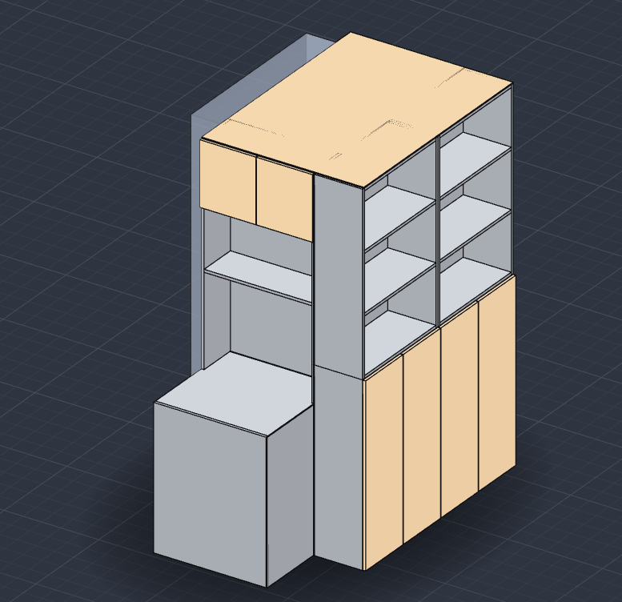
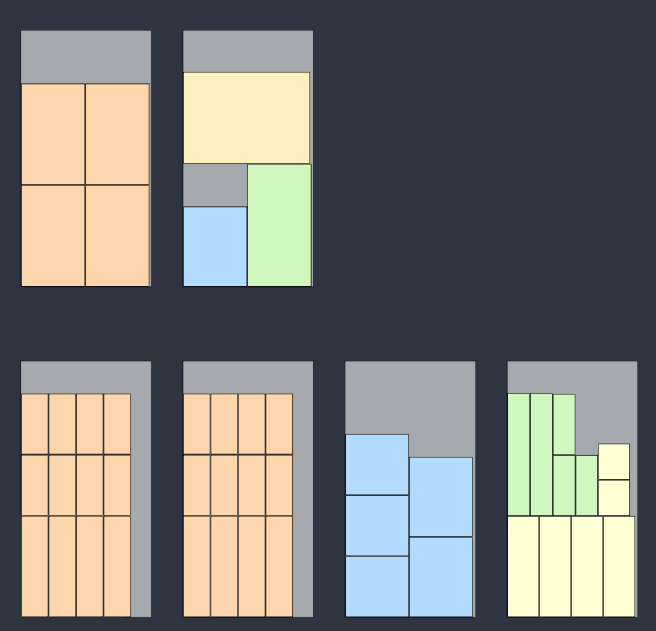
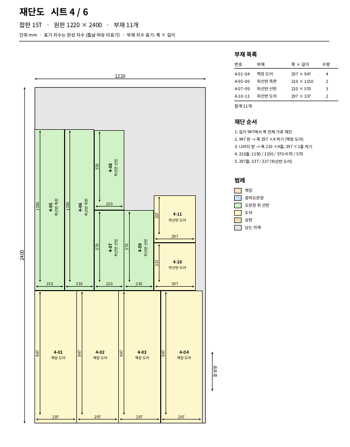

얼마만에 써보는건가
{: .notice}

## 해야 할 것들
  - [ ] 운동 1시간, 수학 1시간, 코딩 1시간 -> 이거 하고있나...
  - [ ] 밀린 공부들
  - [ ] 논문 구현해보기

## 로봇공학회 논문 제출
2월에 있을 학회 참석을 위해 논문을 제출했다. 
물론 내 아이디어는 아니고, 다른 친구가 하던 것을 이어 받아 쓴 것이기에 기여기간은 짧다만, 그래도 나름대로 추가 실험도 붙이고 그림도 새로 그리고. AI가 수고했지....(하..)

새로이 논문을 써 내려가면서, 글쓰는 능력이 이렇게 퇴화했는가 실감하게 된다.   
글의 시작을 하지 못하니 써 내려가는 것도 되지가 않는다. 처음엔 타이핑으로 해봤다가, 다시 손으로 써봤다가. 어떻게든 해보려고 끙끙대긴 했다만, 결국은 AI가 큰 역할을 한다.   

새삼스레 AI의 거대함을 깨닫는다.   

"쓰면 퇴화하고, 안쓰면 도태된다."  

이 말이 정말임을 뼈저리게 실감하게 된다.  
남은건 쓰되 퇴화하지 않도록 몸부림 치는 것일 뿐.  

## 이사 시즌의 고민

버리고 새로 장만할 가구들의 목록이 늘어간다.   
어디보자. 수납장이 두어칸 필요할 듯하고, 식탁도 필요한데 이것저것 따져보면 죄다 돈인지라....

슬슬 이걸 DIY로 해볼까 하는 생각이 들고 있다만..

되겠나. 

가장 큰 문제는 합판 원장을 어떻게 재단하는 부분이다. 
원형톱을 사서 내가 직접할까 싶다가도(이게 사실 제일 혹한다만) 이걸 집에서 할 자신은 없다.   
문제는 소음때문이라... 차라리 이 부분을 비용을 지불하고 맡겨버려야 하나 싶다.

그러면 합판 한장당 대충 1~2만원가량 더 드는건가..? 

고민해서 뭐하겠나 싶어 클로드와 SolidCraft를 연결해 뚱땅뚱땅 만들어본다.   

<figure>
  
  <figcaption>2026-11-26-11-34-24</figcaption>
</figure>

여기까지 만들고, 원장에 배치하고 시방서 만들고까지 채 한시간정도 걸렸다.  

세상의 발전이 무서울따름이다. 

<figure>
  
  <figcaption>2026-11-26-11-36-17</figcaption>
</figure>

<figure>
  
  <figcaption>2026-11-26-11-35-58</figcaption>
</figure>

이쯤되니까.... 안만들면 안될것같은데..

## 자격증 공부

자격증 하나 추가해볼까 싶어서 공부하고 있긴 한데... 
이거 강의가 너무 많은데..? 문제풀이까지 하면 200강이 넘나.......???

90일 준비인데 한번 연장해서 180일이라고 한다면, 하루에 한 강의씩 들어도 모자란단 소리다....
와...... 이거 어케 따라간다냐.

