# 들어가면서. 

하도 오래간만에 이어가니 어디까지 했었는지 까먹을 정도다.   
지난번엔 Diffusion의 기본 개념에 대해 알아봤었었다. 단계적으로 노이즈를 생성해서 더하는 과정을 거쳐 노이즈 이미지를 만들었고, CNN모델을 이용해 노이즈 분포를 추정하는 네트워크를 만들었으며, 그걸 통해 노이즈에서 역으로 이미지를 생성해내는 과정을 거쳤다.   

그러나 결과물은 그닥 기대했던 바는 아니다. 

<figure>
  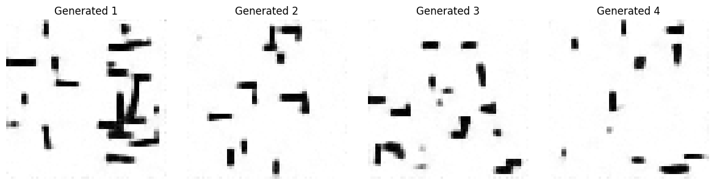
  <figcaption>2026-10-20-14-21-01</figcaption>
</figure>


이제 그 결과물의 성능을 어떻게 높이는지에 대해 알아보자. 


# Conditional Diffusion

Day1과 Day2의 가장 큰 차이는 조건 이미지(Condition Image)를 사용한다는 것이다. 

기존의 Diffusion 노이즈 모델 $e$에 t시간과 t시간의 이미지 말고도 $c$라는 조건 이미지가 더 붙는다. 

$$
\epsilon_\theta(x_t,t) \rightarrow \epsilon_\theta(x_t,t)
$$

이 조건 이미지는 Diffusion의 생성을 일정한 방향으로 유도해주게 된다.   
학습 과정은 다음과 같다. 

```
              정답 CAD 도면 (x₀)
                     │
                     ▼
               Forward Noise
                     │
                     ▼
               Noisy Image (xₜ)
                     │
                     │
                     ▼
입력 약도 (c) ───▶ Conditional U-Net
                     ▲
                     │
                 Timestep (t)
                     │
                     ▼
                예측 노이즈 (ε̂)
                     │
                     ▼
               Loss 계산 및 학습
```

그래서 이번 챕터에서 진행해볼 실습 구성은 다음과 같다. 

| 단계 | 내용 | 핵심 학습 |
|---|---|---|
| 실습 1 | 약도–CAD 도면 데이터셋 생성 | Paired Dataset |
| 실습 2 | Conditional Forward Diffusion | 조건부 생성 구조 |
| 실습 3 | Conditional U-Net 구현 | Image Conditioning |
| 실습 4 | Conditional DDPM 학습 | Noise Prediction |
| 실습 5 | 약도 → CAD 이미지 생성 | Conditional Sampling |


# 데이터셋의 생성

Conditional Diffusion 모델을 학습하려면 입력 이미지와 정답 이미지가 한 쌍으로 구성되어야 한다. 

| 입력 이미지 (Condition) | 정답 이미지 (Target) |
|---|---|
| 삐뚤어진 벽 | 반듯한 벽 |
| 손으로 그린 모서리 | 직각 모서리 |
| 일정하지 않은 선 두께 | 균일한 선 두께 |
| 부정확한 방 구조 | 정돈된 방 구조 |

그래서 실제 CAD도면과 비슷한 약도를 준비해야 하지만....   
그게 잘 없네...? 

그래서 Day1에서 했던 방식대로 일단 정답도면을 만든 다음, 선을 왜곡해서 입력약도를 만들어보자. 이를 통해 관계가 명확한 paired dataset을 얻을 수 있을 것이다. 이미지의 크기는 실습용이므로 96x96으로 해보자. 

## CUDA설정 다시 확인

```python
import torch
import numpy as np
import matplotlib.pyplot as plt

from PIL import Image, ImageDraw
from torch.utils.data import Dataset, DataLoader

# CUDA 설정
device = torch.device(
    "cuda" if torch.cuda.is_available() else "cpu"
)

print("PyTorch:", torch.__version__)
print("Device:", device)

if torch.cuda.is_available():
    print("GPU:", torch.cuda.get_device_name(0))

# 재현성
torch.manual_seed(42)
np.random.seed(42)

# 이미지 크기
IMG_SIZE = 96
```
<figure>
  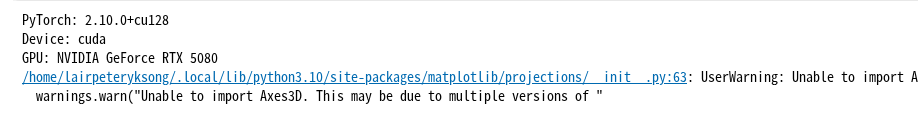
  <figcaption>2026-11-20-19-15-48</figcaption>
</figure>


## 간단한 스타일의 CAD 도면생성

먼저 사각형 외벽과 내부 벽을 가진 간단한 평면도를 생성해본다. 

 - Target: 직선으로 구성된 깨끗한 도면

 - Condition: 선이 조금씩 삐뚤어진 손그림 형태의 약도

또한 벽 일부에 출입구를 표현하기 위한 틈도 같이 만들어보자. 

```python
def make_floorplan_pair(seed, size=IMG_SIZE):

    rng = np.random.default_rng(seed)

    margin = 9

    # 내부 벽의 위치
    x_wall = int(rng.integers(34, size - 34))
    y_wall = int(rng.integers(34, size - 34))

    # 출입구 위치
    v_door = int(
        rng.integers(margin + 18, size - margin - 18)
    )

    h_door = int(
        rng.integers(margin + 18, size - margin - 18)
    )

    half_gap = int(rng.integers(5, 8))

    # 벽을 선분으로 정의
    segments = [

        # 외벽
        (margin, margin, size-margin, margin),
        (size-margin, margin, size-margin, size-margin),
        (size-margin, size-margin, margin, size-margin),
        (margin, size-margin, margin, margin),

        # 세로 내부 벽 (출입구 포함)
        (x_wall, margin, x_wall, v_door-half_gap),
        (x_wall, v_door+half_gap, x_wall, size-margin),

        # 가로 내부 벽 (출입구 포함)
        (margin, y_wall, h_door-half_gap, y_wall),
        (h_door+half_gap, y_wall, size-margin, y_wall)
    ]

    # 정답 CAD 스타일 이미지
    clean = Image.new(
        "L", (size, size), 255
    )

    clean_draw = ImageDraw.Draw(clean)

    # 입력 약도 이미지
    rough = Image.new(
        "L", (size, size), 255
    )

    rough_draw = ImageDraw.Draw(rough)

    for segment in segments:

        # 깨끗한 직선
        clean_draw.line(
            segment,
            fill=0,
            width=2
        )

        # 손그림 형태의 왜곡된 선
        x1, y1, x2, y2 = segment

        length = max(
            abs(x2-x1),
            abs(y2-y1)
        )

        num_knots = max(
            2, int(length // 9) + 1
        )

        points = []

        for alpha in np.linspace(0, 1, num_knots):

            px = (
                x1 + alpha*(x2-x1)
                + rng.normal(0, 1.35)
            )

            py = (
                y1 + alpha*(y2-y1)
                + rng.normal(0, 1.35)
            )

            points.append(
                (round(px), round(py))
            )

        rough_draw.line(
            points,
            fill=int(rng.integers(10, 65)),
            width=int(rng.integers(1, 3))
        )

    # numpy 변환
    clean_arr = (
        np.asarray(clean, dtype=np.float32) / 255.0
    )

    rough_arr = (
        np.asarray(rough, dtype=np.float32) / 255.0
    )

    # 입력 이미지에 약간의 노이즈 추가
    rough_arr = np.clip(
        rough_arr + rng.normal(0, 0.018, (size, size)),
        0, 1
    ).astype(np.float32)

    return rough_arr, clean_arr
```

어떻게 만들어졌는지 한번 확인해보자. 
```python
# 조건 입력(손그림 약도)과 정답(CAD 스타일 도면) 비교
sample_seeds = [0, 1, 2, 3]
fig, axes = plt.subplots(2, len(sample_seeds), figsize=(12, 6))

for col, seed in enumerate(sample_seeds):
    rough_arr, clean_arr = make_floorplan_pair(seed=seed)

    for row, (img, label) in enumerate([
        (rough_arr, "Input: rough sketch"),
        (clean_arr, "Target: clean floorplan"),
    ]):
        axes[row, col].imshow(
            img, cmap="gray", vmin=0, vmax=1, interpolation="nearest"
        )
        axes[row, col].set_title(f"{label} (seed={seed})")
        axes[row, col].axis("off")

fig.suptitle("Conditional diffusion training pairs", fontsize=14)
fig.tight_layout()
plt.show()
```
<figure>
  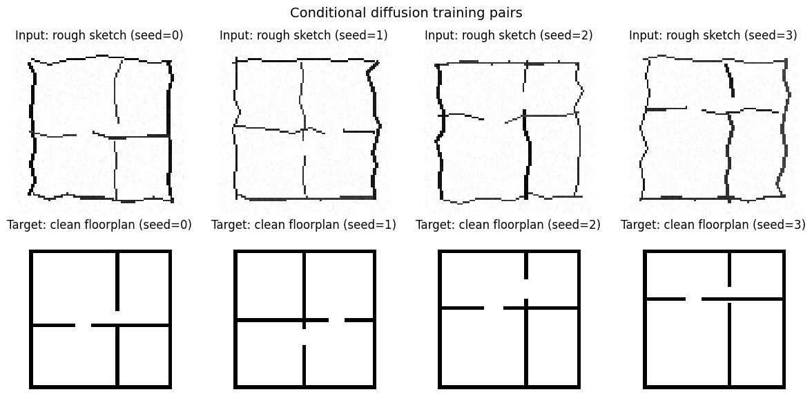
  <figcaption>2026-11-20-19-25-43</figcaption>
</figure>

## 데이터셋의 현

이제 이 이미지 쌍을 데이터셋으로 구현해보자. 데이터셋은 클래스로 구현된다. 자주 안쓰니 까먹는다. 

$$
(c,x_0)
$$

```python
class SyntheticPlanDataset(Dataset):

    def __init__(
        self,
        n=1200,
        size=IMG_SIZE,
        seed=2026
    ):

        self.n = n
        self.size = size
        self.seed = seed

    def __len__(self):

        return self.n

    def __getitem__(self, idx):
        
        #앞서 랜덤하게 데이터셋을 만드는 함수를 쓴다. 
        condition, target = make_floorplan_pair(
            self.seed + int(idx),
            self.size
        )

        # Tensor 변환
        condition = (
            torch.from_numpy(condition).unsqueeze(0)
        )

        target = (
            torch.from_numpy(target).unsqueeze(0)
        )

        # [0,1] -> [-1,1], 간단한 수식을 통한 정규화
        condition = condition * 2 - 1
        target = target * 2 - 1

        return condition, target


# Dataset 생성
dataset = SyntheticPlanDataset(
    n=1200
)

# DataLoader
loader = DataLoader(
    dataset,
    batch_size=16,
    shuffle=True,
    num_workers=0
)

# 배치 확인
condition, target = next(iter(loader))

print("Condition:", condition.shape)
print("Target:", target.shape)
```

실행 결과는 다음과 같다. 

<figure>
  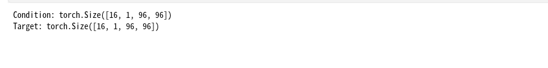
  <figcaption>2026-11-20-19-30-25</figcaption>
</figure>

배치당 16개의 흑백 이미지가 생성되었고, DDPM학습에 사용할 수 있도록 [-1,1] 범위로 정규화도 되었다. 

이제 이걸 가지고 학습과 생성을 이어간다. 

잊지 않기 위해 다시금 수학적 개념들을 상기해보자. 

$$
(c,x_0) \sim p_{\text{data}}(c,x)
$$

$$
x_t =
\sqrt{\bar{\alpha}_t}x_0+
\sqrt{1-\bar{\alpha}_t}\epsilon
$$

$$
\mathcal{L} =
\mathbb{E}_{x_0,c,t,\epsilon}
\left[
\|\epsilon-\epsilon_\theta(x_t,t,c)\|^2
\right]
$$


# Conditional Forward Diffusion 구현

Day 1에서 Forward Diffusion은 다음과 같았다.

$$
x_t=\sqrt{\bar{\alpha}_t}x_0+\sqrt{1-\bar{\alpha}_t}\epsilon
$$

 - $x_0$: 원본 이미지
 - $x_t$: 노이즈가 추가된 이미지
 - $t$: timestep
 - $\epsilon$: Gaussian Noise

여기에 이제 conditional Diffusion이 되면서 조건 이미지가 들어간다.  
그러나 전체 Forward Diffusion 과정 자체에는 변함이 없다. 

```text
입력 약도 (c) ───────────────┐
                                           │
                                           │ 조건 정보
                                           │
정답 CAD (x₀)                              │
    │                                      │
    ▼                                      │
Forward Diffusion                          │
    │                                      │
    ▼                                      │
Noisy CAD (xₜ) ────────┐           │
                               ▼           ▼
                            Conditional U-Net
                                    │
                                    ▼
                                Noise 예측
```

이걸 염두해두고 진행해보자. 

## Noise Schedule 정의
지난번 실습 코드의 앞부분을 다시 반복해본다. 

```python
# ==========================================
# Day 2 - Practice 2
# Conditional Forward Diffusion
# ==========================================

import torch
import matplotlib.pyplot as plt

# Diffusion 설정
T = 1000

# Linear beta schedule
betas = torch.linspace(
    0.0001,
    0.02,
    T,
    device=device
)

alphas = 1.0 - betas

alpha_bars = torch.cumprod(
    alphas,
    dim=0
)

print("T:", T)
print("betas:", betas.shape)
print("alpha_bars:", alpha_bars.shape)
```

이제 정답이미지에 노이즈를 추가하는 함수를 구현해본다. 


```python
def q_sample(x0, t, noise=None):

    """
    x0: (B, C, H, W)
    t : (B,)
    """

    if noise is None:
        noise = torch.randn_like(x0)

    # alpha_bar_t 추출
    sqrt_alpha_bar = torch.sqrt(
        alpha_bars[t]
    ).view(-1, 1, 1, 1)

    sqrt_one_minus_alpha_bar = torch.sqrt(
        1.0 - alpha_bars[t]
    ).view(-1, 1, 1, 1)

    # Forward Diffusion
    xt = (
        sqrt_alpha_bar * x0
        +
        sqrt_one_minus_alpha_bar * noise
    )

    return xt, noise
```

## Conditional Forward Diffusion 시각화

이제 실제로 약도와 정답 이미지를 가져와 노이즈를 추가해보자.

여기서 관찰해야 할 점은 입력 약도는 그대로 유지되지만 정답 이미지는 timestep에 따라 점점 노이즈로 변한다는 것이다.

```python
# Dataset에서 하나의 샘플 추출
condition, target = dataset[0]

# Batch 차원 추가
condition = condition.unsqueeze(0).to(device)
target = target.unsqueeze(0).to(device)

# 시각화용 변환 함수
def to_image(x):
    return (
        (x.detach().cpu().squeeze().numpy() + 1) / 2
    ).clip(0, 1)


# 확인할 timestep
timesteps = [0, 50, 200, 500, 999]

fig, axes = plt.subplots(
    1, 7,
    figsize=(18, 4)
)

# 입력 약도
axes[0].imshow(
    to_image(condition),
    cmap="gray",
    vmin=0,
    vmax=1
)
axes[0].set_title("Condition")

# 정답 CAD
axes[1].imshow(
    to_image(target),
    cmap="gray",
    vmin=0,
    vmax=1
)
axes[1].set_title("Target x0")

# 동일한 noise 사용
fixed_noise = torch.randn_like(target)

# Forward Diffusion
for i, step in enumerate(timesteps):

    t = torch.tensor(
        [step],
        device=device,
        dtype=torch.long
    )

    xt, noise = q_sample(
        target,
        t,
        noise=fixed_noise
    )

    axes[i+2].imshow(
        to_image(xt),
        cmap="gray",
        vmin=0,
        vmax=1
    )

    axes[i+2].set_title(
        f"t = {step}"
    )

for ax in axes:
    ax.axis("off")

plt.tight_layout()
plt.show()
```

<figure>
  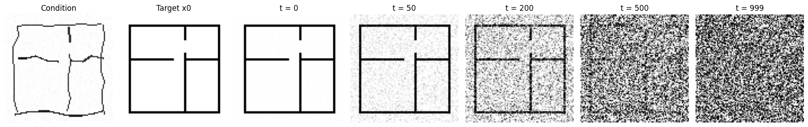
  <figcaption>2026-11-20-19-58-25</figcaption>
</figure>

눈을 크게 뜨고 보면, Target x_0에 노이즈가 점점 추가되기는 하는데, 노이즈에 미묘한 패턴이 보인다. 어찌되었건, 입력 약도는 그대로 유지되지만 정답 이미지는 timestep에 따라 점점 노이즈로 변한다.

## 실제 학습에 필요한 입력 구성

이제 중요한 부분이다. 

어쨌거나, Diffusion이란 것은 노이즈를 단계적으로 넣고, 빼고 하는 과정을 거치므로 노이즈 제거의 과정의 네트워크로 인코더/디코더구조의 Unet 을 사용하는 경우가 많다. 우리의 실습도 그에 맞춰 Conditional Unet이다. 그럼 이걸 구성하면서 어떻게 입력을 구성하는지 한번 둘러보자. 

우선 우리가 사용하는 노이즈 모델은 다음과 같이 표현할 수 있다. 

$$
\epsilon_\theta(x_t,t,c)
$$

여러가지 구현방법이 있지만, 이번 실습에서는 가장 간단한 Channel Concatenation을 사용해보자. 

$$
z_t=\operatorname{Concat}(x_t,c)
$$

두 이미지의 크기가 같다고 가정하면, $z_t$ 는 두 이미지를 쌓아 올린게 된다. 

$$
x_t \in \mathbb{R}^{B\times1\times96\times96}
$$
$$
c \in \mathbb{R}^{B\times1\times96\times96}
$$

쌓아 올리면 채널수가 는다. 

$$
z_t \in \mathbb{R}^{B\times2\times96\times96}
$$

그걸 코드로 구현하면 다음과 같다. 

```python
# DataLoader에서 배치 가져오기
condition_batch, target_batch = next(iter(loader))

condition_batch = condition_batch.to(device)
target_batch = target_batch.to(device)

B = target_batch.shape[0]

# 각 이미지에 대해 timestep 무작위 선택
t = torch.randint(
    low=0,
    high=T,
    size=(B,),
    device=device
)

# 정답 CAD에만 노이즈 추가
xt, noise = q_sample(
    target_batch,
    t
)

# 조건 이미지와 noisy CAD 결합
model_input = torch.cat(
    [xt, condition_batch],
    dim=1
)

print("Condition:", condition_batch.shape)
print("Target:", target_batch.shape)
print("Noisy Target:", xt.shape)
print("Model Input:", model_input.shape)
print("Noise Target:", noise.shape)
print("Timestep:", t.shape)
```
실행해보면 다음과 같다. 
주목할 만한 것은, 모델의 입력은 2채널인데, 출력은 1채널이란 것이다. 왜냐하면 모델이 예측해야 할 것은 정답 CAD 이미지에 추가된 노이즈만이기 때문이다. 

<figure>
  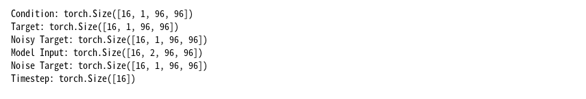
  <figcaption>2026-11-20-20-13-00</figcaption>
</figure>

## Conditional DDPM의 전체 학습 구조

지금까지 구현한걸 한번 돌아보자. 

```

                Paired Dataset
                      │
              ┌───┴─────┐
              │                  │
              ▼                  ▼
          입력 약도(c)        정답 CAD(x₀)
              │                  │
              │                  ▼
              │           Random timestep
              │                  │
              │                  ▼
              │           Forward Diffusion
              │                  │
              │                  ▼
              │             Noisy CAD(xₜ)
              │                  │
              │                  │
              └───┬─────┘
                      │
                      ▼
             Channel Concatenation
                      │
                      ▼
                 (B,2,96,96)
                      │
                      │  + timestep t
                      ▼
               Conditional U-Net
                      │
                      ▼
                 예측 노이즈
                (B,1,96,96)
                      │
                      ▼
                 MSE Loss
                      ▲
                      │
                실제 노이즈 ε
```

학습 과정에서는 매번 다른 timestep을 선택한다.  

따라서 모델은 노이즈가 적은 이미지부터 거의 순수한 노이즈까지 다양한 상태에서 도면의 구조를 복원하는 방법을 학습하게 된다. 

# Conditional U-Net 구현

노이즈 모델과 입/출력관계를 정의했으면, 이제 본격적으로 네트워크를 구현할 차례다.

오늘 구현할 네트워크는 다음과 같다. 

```
         Noisy CAD (xₜ)
               │
               │
         Input Sketch (c)
               │
               ▼
       Channel Concatenation
               │
               ▼
         (B, 2, 96, 96)
               │
               ▼
        Input Convolution
               │
               ▼
         (B, 32, 96, 96)
               │
               ▼
        Encoder Block 1 ───────────┐
               │                            │
               ▼                            │
          Downsample                        │
               │                            │
               ▼                            │
         (B, 64, 48, 48)                    │
               │                            │
               ▼                            │
        Encoder Block 2 ──────┐        │
               │                   │        │
               ▼                   │        │
          Downsample               │        │
               │                   │        │
               ▼                   │        │
        (B, 128, 24, 24)           │        │
               │                   │        │
               ▼                   │        │
         Middle Blocks             │        │
               │                   │        │
               ▼                   │        │
           Upsample                │        │
               │                   │        │
               ▼                   ▼        │
          Decoder Block 2 ◀────┘        │
               │                            │
               ▼                            │
           Upsample                         │
               │                            │
               ▼                            ▼
          Decoder Block 1 ◀─────────┘
               │
               ▼
         Output Convolution
               │
               ▼
         (B, 1, 96, 96)
               │
               ▼
          Predicted Noise
```

위의 순서도는 기본적인 Unet의 특징을 잘 보여준다. 다음 세가지는 정의를 한번 짚어보자. 

- Encoder : 이미지의 특징을 추출하면서 공간 해상도를 줄인다. 
- Decoder : 추출한 특징을 이용하여 원래 이미지 크기로 복원한다. 
- Skip connection : Encoder에서 추출한 특징을 Decoder로 직접 전달한다. 

## Time Embedding

우리는 지난번에 이미 Time embedding을 사용했었다. day1에서는 아래에 이미 t가 있다. 이게 타임 임베딩이다. 

$$
\epsilon(x_t, t)
$$

이걸 Conditional U-Net에 사용할 형태로 구현한다. time embedding 이 필요한 이유는 t = 50일때와 t = 950일때의 노이즈의 양이 다르기 때문에 학습 중에 여기에 들어간 노이즈가 얼마인지 수준을 알기 위해 time-stamp가 필요하게 된다. 

여기선 Sinusoidal Embedding 을 사용한다. 

```python
import math

import torch
import torch.nn as nn
import torch.nn.functional as F


class SinusoidalTimeEmbedding(nn.Module):

    def __init__(self, dim=128):
        super().__init__()

        assert dim % 2 == 0
        self.dim = dim

    def forward(self, t):

        half = self.dim // 2

        freqs = torch.exp(
            torch.arange(
                half,
                device=t.device,
                dtype=torch.float32
            )
            * (-math.log(10000) / (half - 1))
        )

        angles = t.float()[:, None] * freqs[None, :]

        embedding = torch.cat(
            [
                angles.sin(),
                angles.cos()
            ],
            dim=-1
        )

        return embedding

time_embedding = SinusoidalTimeEmbedding(
    dim=128
).to(device)

t_test = torch.tensor(
    [10, 100, 500, 900],
    device=device
)

emb = time_embedding(t_test)

print("Timestep:", t_test.shape)
print("Embedding:", emb.shape)

```

실행결과는 이렇다. 

<figure>
  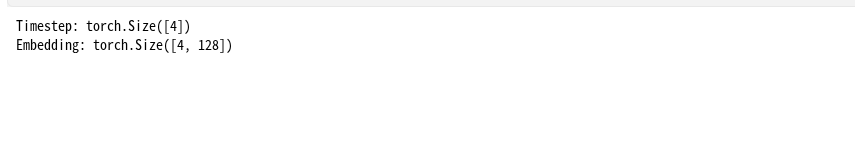
  <figcaption>2026-11-20-21-24-55</figcaption>
</figure>

## Residual Block 구현

이제 U-net을 구성하는 기본 블록을 구현해본다. 

일반적인 CNN 블록에 Time-Embedding 을 추가한다.

```
        Feature Map (x)
              │
              ▼
          GroupNorm
              │
              ▼
             SiLU
              │
              ▼
         Convolution
              │
              ◀──────── Time Embedding
              │
              ▼
          GroupNorm
              │
              ▼
             SiLU
              │
              ▼
         Convolution
              │
              +
              ▲
              │
         Residual Skip
              │
              ▼
           Output
```
일반적인 CNN과 다른 점은 timestep 정보를 특징 맵에 추가한다는 것이다.

$$
h=\operatorname{Conv}_1(\operatorname{SiLU}(\operatorname{GN}(x)))
$$

$$
h'=h+W_t\operatorname{SiLU}(e_t)
$$

$$
y=\operatorname{Conv}_2(\operatorname{SiLU}(\operatorname{GN}(h')))+W_sx
$$

Residual Block의 코드 구현은 다음과 같다. 

```python
class ResBlock(nn.Module):

    def __init__(
        self,
        in_channels,
        out_channels,
        time_dim=128
    ):
        super().__init__()

        # 첫 번째 Convolution
        self.norm1 = nn.GroupNorm(
            8, in_channels
        )

        self.conv1 = nn.Conv2d(
            in_channels,
            out_channels,
            kernel_size=3,
            padding=1
        )

        # Time Embedding Projection
        self.time_proj = nn.Linear(
            time_dim,
            out_channels
        )

        # 두 번째 Convolution
        self.norm2 = nn.GroupNorm(
            8, out_channels
        )

        self.conv2 = nn.Conv2d(
            out_channels,
            out_channels,
            kernel_size=3,
            padding=1
        )

        # Residual Connection
        if in_channels == out_channels:

            self.skip = nn.Identity()

        else:

            self.skip = nn.Conv2d(
                in_channels,
                out_channels,
                kernel_size=1
            )

    def forward(self, x, time_emb):

        # 첫 번째 Convolution
        h = self.conv1(
            F.silu(self.norm1(x))
        )

        # Time Embedding 추가
        time_feature = self.time_proj(
            F.silu(time_emb)
        )

        h = h + time_feature[:, :, None, None]

        # 두 번째 Convolution
        h = self.conv2(
            F.silu(self.norm2(h))
        )

        # Residual Connection
        return h + self.skip(x)
```

코드 중간에 Time Embedding 추가 주석이 있는 부분이 있다.   

각 단계에서의 텐서는 다음과 같다. 
  1. Time Embedding [time_feature = self.time_proj]: (16,128)
  2. Time Embedding Projection [self.time_proj = nn.Linear]: (16,128) -> (16,64)
  3. 차원 확장(Unsqueeze)  [time_feature[:, :, None, None]] : (16,64) -> (16,64,1,1)
  4. Broadcasting을 통한 Feature Map과의 덧셈
     Feature Map의 크기가 다음과 같다면,

        $$
        h\in\mathbb{R}^{16\times64\times48\times48}
        $$

     Time Embedding은 Broadcasting을 통해 공간 차원으로 확장되어 더해진다.

        $$
        \underbrace{(16,64,48,48)}_{\text{Feature Map}}
        +
        \underbrace{(16,64,1,1)}_{\text{Time Embedding}}
        $$

     결과는 (16,64,48,48)가 된다.

$$
(16,128)
\xrightarrow{\text{Linear}}
(16,64)
\xrightarrow{\text{Unsqueeze}}
(16,64,1,1)
\xrightarrow{\text{Broadcasting}}
(16,64,48,48)
$$

## Conditional U-Net 구현

이제 전체 모델을 구현한다. 네트워크는 다음과 같이 구성은 다음과 같다. 

| 구성 | 채널 | 이미지 크기 |
|---|---|---|
| Input | 2 | 96×96 |
| Encoder 1 | 32 | 96×96 |
| Encoder 2 | 64 | 48×48 |
| Middle | 128 | 24×24 |
| Decoder 2 | 64 | 48×48 |
| Decoder 1 | 32 | 96×96 |
| Output | 1 | 96×96 |

입력 이미지 크기 96×96에 맞추어 두 번 Downsampling한다. 

```python
class ConditionalUNet(nn.Module):

    def __init__(
        self,
        in_channels=2,
        out_channels=1,
        base_channels=32,
        time_dim=128
    ):
        super().__init__()

        c = base_channels

        # =================================
        # 1. Time Embedding
        # =================================

        self.time_mlp = nn.Sequential(

            SinusoidalTimeEmbedding(time_dim),

            nn.Linear(
                time_dim,
                time_dim * 4
            ),

            nn.SiLU(),

            nn.Linear(
                time_dim * 4,
                time_dim
            )
        )

        # =================================
        # 2. Input Layer
        # =================================

        self.input_conv = nn.Conv2d(
            in_channels,
            c,
            kernel_size=3,
            padding=1
        )

        # =================================
        # 3. Encoder
        # =================================

        self.enc1 = ResBlock(
            c, c, time_dim
        )

        self.down1 = nn.Conv2d(
            c,
            c * 2,
            kernel_size=3,
            stride=2,
            padding=1
        )

        self.enc2 = ResBlock(
            c * 2,
            c * 2,
            time_dim
        )

        self.down2 = nn.Conv2d(
            c * 2,
            c * 4,
            kernel_size=3,
            stride=2,
            padding=1
        )

        # =================================
        # 4. Middle
        # =================================

        self.mid1 = ResBlock(
            c * 4,
            c * 4,
            time_dim
        )

        self.mid2 = ResBlock(
            c * 4,
            c * 4,
            time_dim
        )

        # =================================
        # 5. Decoder
        # =================================

        self.up2 = nn.ConvTranspose2d(
            c * 4,
            c * 2,
            kernel_size=4,
            stride=2,
            padding=1
        )

        self.dec2 = ResBlock(
            c * 4,
            c * 2,
            time_dim
        )

        self.up1 = nn.ConvTranspose2d(
            c * 2,
            c,
            kernel_size=4,
            stride=2,
            padding=1
        )

        self.dec1 = ResBlock(
            c * 2,
            c,
            time_dim
        )

        # =================================
        # 6. Output
        # =================================

        self.output_norm = nn.GroupNorm(
            8, c
        )

        self.output_conv = nn.Conv2d(
            c,
            out_channels,
            kernel_size=3,
            padding=1
        )

    def forward(self, x, t):

        # Time Embedding
        time_emb = self.time_mlp(t)

        # =================================
        # Encoder
        # =================================

        e1 = self.enc1(
            self.input_conv(x),
            time_emb
        )

        e2 = self.enc2(
            self.down1(e1),
            time_emb
        )

        # =================================
        # Middle
        # =================================

        h = self.down2(e2)

        h = self.mid1(
            h, time_emb
        )

        h = self.mid2(
            h, time_emb
        )

        # =================================
        # Decoder
        # =================================

        h = self.up2(h)

        # Skip Connection
        h = torch.cat(
            [h, e2],
            dim=1
        )

        h = self.dec2(
            h, time_emb
        )

        h = self.up1(h)

        # Skip Connection
        h = torch.cat(
            [h, e1],
            dim=1
        )

        h = self.dec1(
            h, time_emb
        )

        # =================================
        # Output
        # =================================

        h = self.output_conv(
            F.silu(self.output_norm(h))
        )

        return h
```


## 모델 생성 및 확인

이제 모델을 GPU에 올리고 파라미터 수를 확인해보자. 

```python
model = ConditionalUNet(
    in_channels=2,
    out_channels=1,
    base_channels=32,
    time_dim=128
).to(device)

num_params = sum(
    p.numel()
    for p in model.parameters()
)

print("Device:", device)

print(
    f"Model Parameters: {num_params:,}"
)
```
<figure>
  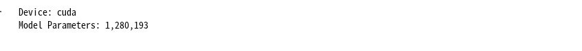
  <figcaption>2026-11-20-21-45-02</figcaption>
</figure>

## Forward Pass 테스트
이제 실제로 모델에 데이터를 입력해서 테스트해보자. 앞서 만든 코드를 활용하자.

```python
# ====================================
# 1. Dataset에서 Batch 가져오기
# ====================================

condition, target = next(iter(loader))

condition = condition.to(device)
target = target.to(device)

B = target.shape[0]

# ====================================
# 2. Random Timestep
# ====================================

t = torch.randint(
    0,
    T,
    (B,),
    device=device
)

# ====================================
# 3. Forward Diffusion
# ====================================

xt, noise = q_sample(
    target,
    t
)

# ====================================
# 4. Conditional Input
# ====================================

model_input = torch.cat(
    [xt, condition],
    dim=1
)

# ====================================
# 5. Conditional U-Net
# ====================================

model.eval()

with torch.no_grad():

    predicted_noise = model(
        model_input,
        t
    )

# ====================================
# 6. Shape 확인
# ====================================

print("Condition:", condition.shape)

print("Target:", target.shape)

print("Noisy CAD:", xt.shape)

print("Model Input:", model_input.shape)

print("Predicted Noise:", predicted_noise.shape)

print("Actual Noise:", noise.shape)

assert predicted_noise.shape == noise.shape

print("\nForward Pass Success!")
```
<figure>
  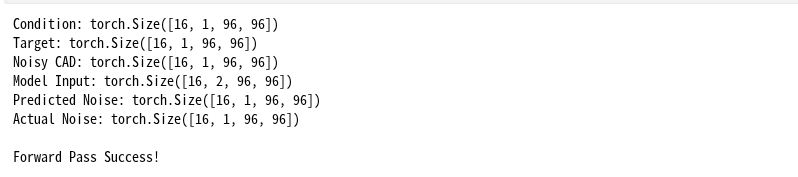
  <figcaption>2026-11-20-21-47-18</figcaption>
</figure>

## 현재 모델의 Loss 확인
마지막으로 현재 모델이 실제 노이즈를 얼마나 잘 예측하는지 확인하자. 

Loss 는 다음과 같다. MSE Loss다. 

$$
\mathcal L=
\frac{1}{N}
\sum_{i=1}^{N}
(\epsilon_i-\hat{\epsilon}_i)^2
$$

```python
loss = F.mse_loss(
    predicted_noise,
    noise
)

print(
    f"Initial MSE Loss: {loss.item():.6f}"
)
```
<figure>
  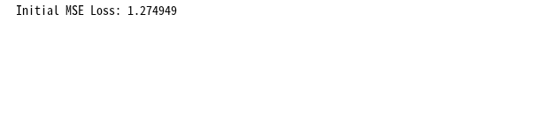
  <figcaption>2026-11-20-21-48-50</figcaption>
</figure>


# Conditional DDPM 학습 (Training)

지금까지 신경망을 구현하고 입력·출력 형태를 확인했. 이번에는 처음으로 모델의 가중치 $\theta$를 업데이트해보자. 

학습중에 확인해야 할건 다음과 같다. 

 - 학습이 진행되면서 Loss가 감소하는가?
 - 모델이 실제 노이즈를 예측할 수 있게 되는가?
 - 입력 약도(Condition)를 학습에 활용하고 있는가?

실습에서는 SR3와 Palette에서 사용하는 조건부 노이즈 예측 학습의 기본 원리를 실습용에 맞게 단순화한것임을 미리 이야기한다. 논문은 마지막에 붙여보자. 

## 학습 원리

Conditional DDPM의 학습 과정은 다음과 같다.

```
        Paired Dataset
               │
      ┌───┴─────┐
      │                  │
      ▼                  ▼
   약도 (c)          CAD 도면 (x₀)
      │                  │
      │                  ▼
      │              Noise 추가
      │                  │
      │                  ▼
      │                 xₜ
      │                  │
      └───┬─────┘
               │
               ▼
       Conditional U-Net
               │
               ▼
          예측 노이즈
               │
               ▼
          MSE Loss 계산
               ▲
               │
           실제 노이즈
               │
               ▼
           Backpropagation
               │
               ▼
         Weight Update
```

## Loss Function

사용할 목적함수는 다음과 같다. 실제 구현에서는 픽셀과 배치 차원에 대해 평균을 취한 MSE를 사용한다.

$$
\mathcal{L}_{\mathrm{simple}}
=
\mathbb{E}_{x_0,c,t,\epsilon}
\left[
\left\|
\epsilon-
\epsilon_\theta(x_t,t,c)
\right\|_2^2
\right]
$$

$x_0$ : 정답 CAD 도면
$c$ : 입력 약도
$t$ : 무작위로 선택한 timestep
$\epsilon$ : 실제 Gaussian Noise
$\epsilon_\theta$ : Conditional U-Net이 예측한 노이즈

핵심은 모델이 정답 CAD 이미지를 직접 예측하는 것이 아니라, 정답 이미지에 추가된 노이즈를 예측하도록 학습한다는 점이다. 모델은 입력 약도를 참고할 수 있으므로, 학습이 잘 이루어지면 약도의 구조와 일치하는 이미지를 생성하는 데 필요한 정보를 활용할 수 있게 된다. 

## 학습 데이터의 준비

제일 먼저 데이터를 준비할때 1,200개의 이미지 쌍을 만들었다. 여기서 training 과 validation을 구분해보자. 

| 데이터 | 개수 | 목적 |
|---|---:|---|
| Training | 1,080 | 모델 가중치 업데이트 |
| Validation | 120 | 학습되지 않은 데이터에 대한 평가 |
| 합계 | 1,200 | |

```python
# ==========================================
# Day 2 - Practice 4
# Conditional DDPM Training
# ==========================================

import torch
import torch.nn as nn
import torch.nn.functional as F

import numpy as np
import matplotlib.pyplot as plt

from pathlib import Path
from time import perf_counter

from torch.utils.data import DataLoader, random_split


# ------------------------------------------
# 1. GPU 설정
# ------------------------------------------

device = torch.device(
    "cuda" if torch.cuda.is_available() else "cpu"
)

print("Device:", device)


# ------------------------------------------
# 2. Dataset 분리
# ------------------------------------------

train_size = int(len(dataset) * 0.9)
val_size = len(dataset) - train_size

train_dataset, val_dataset = random_split(
    dataset,
    [train_size, val_size],
    generator=torch.Generator().manual_seed(42)
)


# ------------------------------------------
# 3. DataLoader
# ------------------------------------------

batch_size = 16

train_loader = DataLoader(
    train_dataset,
    batch_size=batch_size,
    shuffle=True,
    num_workers=0,
    pin_memory=(device.type == "cuda")
)

val_loader = DataLoader(
    val_dataset,
    batch_size=batch_size,
    shuffle=False,
    num_workers=0,
    pin_memory=(device.type == "cuda")
)


print("Train samples:", len(train_dataset))
print("Validation samples:", len(val_dataset))


# ------------------------------------------
# 4. Conditional U-Net 생성
# ------------------------------------------

model = ConditionalUNet(
    in_channels=2,
    out_channels=1,
    base_channels=32,
    time_dim=128
).to(device)


# ------------------------------------------
# 5. Optimizer
# ------------------------------------------

learning_rate = 2e-4

optimizer = torch.optim.Adam(
    model.parameters(),
    lr=learning_rate
)


# ------------------------------------------
# 6. Checkpoint 저장 경로
# ------------------------------------------

checkpoint_dir = Path("./checkpoints_day2")

checkpoint_dir.mkdir(
    parents=True,
    exist_ok=True
)

best_model_path = checkpoint_dir / "conditional_ddpm_best.pt"
last_model_path = checkpoint_dir / "conditional_ddpm_last.pt"

print("Checkpoint Directory:", checkpoint_dir)
```

학습 설정 파라미터는 다음과 같다. 
- T = 1000, Diffusion의 timestamp다. 
- Batch size = 16
- $\eta=2\times10^{-4}$ 학습률, learning rate를 말한다. 


## Validation함수 구현

학습전 검증을 위한 함수를 먼저 작성하자. 

```python
def evaluate_model(model, val_loader):

    model.eval()

    total_loss = 0.0
    total_samples = 0

    # 매 Epoch에서 동일한 난수 조건 사용
    # Validation Loss 비교를 안정화하기 위함
    val_generator = torch.Generator(
        device=device
    ).manual_seed(2026)

    with torch.no_grad():

        for condition, target in val_loader:

            condition = condition.to(device)
            target = target.to(device)

            B = target.shape[0]

            # Random timestep
            t = torch.randint(
                0,
                T,
                (B,),
                device=device,
                generator=val_generator
            )

            # Gaussian Noise
            noise = torch.randn(
                target.shape,
                device=device,
                dtype=target.dtype,
                generator=val_generator
            )

            # Forward Diffusion
            xt, noise = q_sample(
                target,
                t,
                noise=noise
            )

            # Conditional Input
            model_input = torch.cat(
                [xt, condition],
                dim=1
            )

            # Noise Prediction
            predicted_noise = model(
                model_input,
                t
            )

            # Loss
            loss = F.mse_loss(
                predicted_noise,
                noise
            )

            total_loss += loss.item() * B
            total_samples += B

    avg_loss = total_loss / total_samples

    return avg_loss
```

## Conditional DDPM 학습

드디어 실습이다. 일단 20 epoch만 해보자. 나중에 Loss 그래프를 보고 추가학습을 결정하자. 

학습 과정은 다음과 같다. 

$$
\begin{aligned}
t &\sim U\{0,\ldots,T-1\}\\
\epsilon &\sim \mathcal N(0,I)\\
x_t &=\sqrt{\bar\alpha_t}x_0+
\sqrt{1-\bar\alpha_t}\epsilon\\
\hat\epsilon &=\epsilon_\theta(x_t,t,c)\\
\mathcal L &=\operatorname{MSE}(\epsilon,\hat\epsilon)
\end{aligned}
$$

이후 Gradient를 계산하여 가중치를 업데이트 한다. 

$$
\theta\leftarrow
\theta-\eta\nabla_\theta\mathcal L
$$

Training loop코드는 다음과 같다. 

```python
# ==========================================
# Training Configuration
# ==========================================

num_epochs = 20

train_losses = []
val_losses = []

best_val_loss = float("inf")


# ==========================================
# Training
# ==========================================

for epoch in range(1, num_epochs + 1):

    start_time = perf_counter()

    model.train()

    running_loss = 0.0
    total_samples = 0

    # --------------------------------------
    # Mini-batch Training
    # --------------------------------------

    for condition, target in train_loader:

        condition = condition.to(
            device,
            non_blocking=True
        )

        target = target.to(
            device,
            non_blocking=True
        )

        B = target.shape[0]

        # ==================================
        # Step 1. Random Timestep
        # ==================================

        t = torch.randint(
            0,
            T,
            (B,),
            device=device
        )

        # ==================================
        # Step 2. Forward Diffusion
        # ==================================

        xt, noise = q_sample(
            target,
            t
        )

        # ==================================
        # Step 3. Conditional Input
        # ==================================

        model_input = torch.cat(
            [xt, condition],
            dim=1
        )

        # ==================================
        # Step 4. Noise Prediction
        # ==================================

        predicted_noise = model(
            model_input,
            t
        )

        # ==================================
        # Step 5. Loss
        # ==================================

        loss = F.mse_loss(
            predicted_noise,
            noise
        )

        # ==================================
        # Step 6. Backpropagation
        # ==================================

        optimizer.zero_grad(
            set_to_none=True
        )

        loss.backward()

        # Gradient Clipping
        torch.nn.utils.clip_grad_norm_(
            model.parameters(),
            max_norm=1.0
        )

        # ==================================
        # Step 7. Weight Update
        # ==================================

        optimizer.step()

        # Loss 누적
        running_loss += loss.item() * B
        total_samples += B

    # ======================================
    # Epoch Training Loss
    # ======================================

    train_loss = running_loss / total_samples

    # ======================================
    # Validation
    # ======================================

    val_loss = evaluate_model(
        model,
        val_loader
    )

    train_losses.append(train_loss)
    val_losses.append(val_loss)

    # ======================================
    # Best Model 저장
    # ======================================

    if val_loss < best_val_loss:

        best_val_loss = val_loss

        torch.save(
            model.state_dict(),
            best_model_path
        )

    # ======================================
    # Last Checkpoint 저장
    # ======================================

    torch.save(
        {
            "epoch": epoch,
            "model_state_dict": model.state_dict(),
            "optimizer_state_dict": optimizer.state_dict(),
            "train_losses": train_losses,
            "val_losses": val_losses,
            "best_val_loss": best_val_loss,
        },
        last_model_path
    )

    # ======================================
    # Training Log
    # ======================================

    elapsed = perf_counter() - start_time

    print(
        f"Epoch [{epoch:02d}/{num_epochs}] "
        f"Train Loss: {train_loss:.6f} | "
        f"Val Loss: {val_loss:.6f} | "
        f"Time: {elapsed:.1f}s"
    )


print("\nTraining Complete!")
print(f"Best Validation Loss: {best_val_loss:.6f}")
```

<figure>
  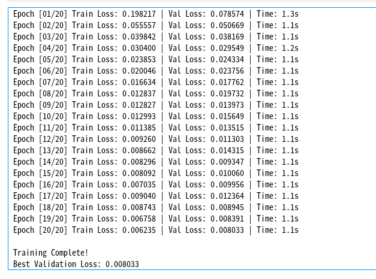
  <figcaption>2026-11-20-22-31-50</figcaption>
</figure>


## 실습 그래프 확인

이제 Train loss와 Validation loss를 확인해보자. 

```python
plt.figure(figsize=(9, 5))

plt.plot(
    train_losses,
    label="Train Loss",
    linewidth=2
)

plt.plot(
    val_losses,
    label="Validation Loss",
    linewidth=2
)

plt.xlabel("Epoch")
plt.ylabel("MSE Loss")

plt.title(
    "Conditional DDPM Training"
)

plt.legend()
plt.grid(alpha=0.3)

plt.tight_layout()
plt.show()
```

<figure>
  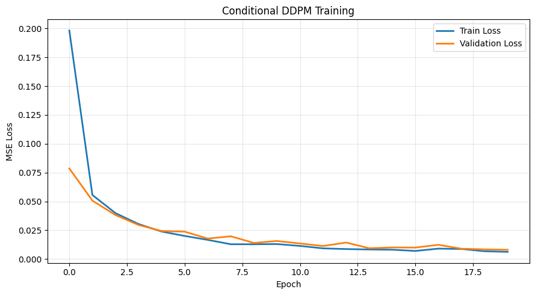
  <figcaption>2026-11-20-22-33-45</figcaption>
</figure>

## 노이즈 예측 및 원본 추정

이제 이걸로 원본을 한번 추정해보자. 잘 나오려나.

```python
# ==========================================
# Best Model 불러오기
# ==========================================

model.load_state_dict(
    torch.load(
        best_model_path,
        map_location=device,
        weights_only=True
    )
)

model.eval()


# ==========================================
# Validation Sample
# ==========================================

condition, target = val_dataset[0]

condition = condition.unsqueeze(0).to(device)
target = target.unsqueeze(0).to(device)


# ==========================================
# Timestep 설정
# ==========================================

t_value = 300

t = torch.tensor(
    [t_value],
    device=device,
    dtype=torch.long
)


# ==========================================
# Forward Diffusion
# ==========================================

xt, true_noise = q_sample(
    target,
    t
)


# ==========================================
# Noise Prediction
# ==========================================

with torch.no_grad():

    model_input = torch.cat(
        [xt, condition],
        dim=1
    )

    predicted_noise = model(
        model_input,
        t
    )


# ==========================================
# x0 추정
# ==========================================

alpha_bar_t = alpha_bars[t].view(
    -1, 1, 1, 1
)

x0_pred = (
    xt
    -
    torch.sqrt(1 - alpha_bar_t)
    * predicted_noise
) / torch.sqrt(alpha_bar_t)


# ==========================================
# 시각화 함수
# ==========================================

def show_img(x):

    return (
        (x.detach().cpu().squeeze().numpy() + 1) / 2
    ).clip(0, 1)


# ==========================================
# Visualization
# ==========================================

fig, axes = plt.subplots(
    1, 4,
    figsize=(14, 4)
)

images = [
    condition,
    target,
    xt,
    x0_pred
]

titles = [
    "Condition",
    "Target CAD",
    f"Noisy CAD (t={t_value})",
    "Predicted x0"
]

for ax, img, title in zip(
    axes,
    images,
    titles
):

    ax.imshow(
        show_img(img),
        cmap="gray",
        vmin=0,
        vmax=1
    )

    ax.set_title(title)
    ax.axis("off")

plt.tight_layout()
plt.show()
```

실행해보면 다음과 같다. 

<figure>
  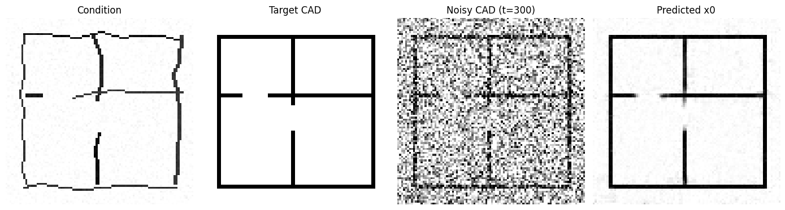
  <figcaption>2026-11-20-22-35-40</figcaption>
</figure>

| 이미지 | 의미 |
|---|---|
| Condition | 입력 약도 |
| Target CAD | 실제 정답 이미지 |
| Noisy CAD | 정답에 노이즈가 추가된 이미지 |
| Predicted x0 | 모델의 노이즈 예측으로 복원한 이미지 |

이 결과는 최종적인 Conditional Diffusion 생성 결과가 아니다. 지금은 정답 이미지에 노이즈를 추가한 후 다시 복원하는 과정일 뿐이다. 따라서 모델은 여전히 $x_t$에 남아 있는 정답 이미지의 정보를 활용하고 있다. .

완전히 새로운 CAD 스타일 이미지를 생성하기 위해 다음 실습에서는 순수한 Gaussian Noise로 시작하는 Reverse Diffusion을 시도해본다. 

## 추가 실험 : 모델이 정말 Condition을 사용하는가?

근데, 학습과정은 동일한것 같은데, 정말 모델에 condition 이미지가 들어갔는가 궁금하지 않나. 

다음과 같은 실험을 해보자.   

실험 A는 정확한 약도를 조건으로 제공하고, 실험 B는 다른 이미지를 약도로 제공해보자. 

$$
\hat\epsilon_A=\epsilon_\theta(x_t,t,c_{\mathrm{correct}})
$$
$$
\hat\epsilon_B=\epsilon_\theta(x_t,t,c_{\mathrm{wrong}})
$$

만약 모델이 조건 정보를 유용하게 학습했다면 올바른 조건을 사용했을 때 Loss가 더 작을 것으로 기대할 수 있다.

```python
model.eval()

condition, target = next(iter(val_loader))

condition = condition.to(device)
target = target.to(device)

B = target.shape[0]

# 조건 정보의 영향을 관찰하기 위해
# 노이즈가 비교적 많은 timestep 사용
t = torch.full(
    (B,),
    650,
    device=device,
    dtype=torch.long
)

# 동일한 노이즈 사용
noise = torch.randn_like(target)

xt, noise = q_sample(
    target,
    t,
    noise=noise
)

# 잘못된 Condition 생성
# Batch 내 Condition 순서를 변경
wrong_condition = condition.roll(
    shifts=1,
    dims=0
)

with torch.no_grad():

    # Correct Condition
    input_correct = torch.cat(
        [xt, condition],
        dim=1
    )

    pred_correct = model(
        input_correct,
        t
    )

    # Wrong Condition
    input_wrong = torch.cat(
        [xt, wrong_condition],
        dim=1
    )

    pred_wrong = model(
        input_wrong,
        t
    )

    # Loss 비교
    loss_correct = F.mse_loss(
        pred_correct,
        noise
    )

    loss_wrong = F.mse_loss(
        pred_wrong,
        noise
    )

print(
    f"Correct Condition Loss: {loss_correct.item():.6f}"
)

print(
    f"Wrong Condition Loss:   {loss_wrong.item():.6f}"
)
```
결과는 이렇다. 그래도 활용 안하는건 아니네. 

<figure>
  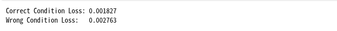
  <figcaption>2026-11-20-22-47-30</figcaption>
</figure>

그래도 그 차이가 소숫점 셋째짜리면 좀 작다. 그 이유를 꼽아보자면 이렇다. 
- 학습이 아직 충분하지 않음
- 모델이 $x_t$에 포함된 정보에 주로 의존함
- 입력 약도와 정답의 관계가 너무 단순함
- 현재 timestep에서 조건 정보의 효과가 작음

다만, 방금 실험은 하나의 배치와 하나의 timestep에 대해 간단히 진단한 것이므로, 여러 데이터를 놓고 성능을 비교해봐야 하겠다. 

이제 다음 단계로 넘어가보자. 

# Conditional Reverse Diffusion 및 CAD 도면 생성

지금까지 학습한 Conditional DDPM을 이용하여 실제로 약도에서 CAD 스타일 도면을 생성하자.  

이번 실습이 중요한 이유는 처음으로 정답 CAD 이미지 없이, 입력 약도만으로 새로운 이미지를 생성하기 때문이다. 앞서 구현한 DDPM과 Conditional U-Net을 그대로 활용하자.

주요 학습 주안점은 다음과 같다. 

- 학습된 Conditional U-Net 불러오기
- DDPM Reverse Sampling 구현
- Gaussian Noise에서 CAD 스타일 도면 생성
- 생성 과정 시각화
- 입력 약도의 구조가 출력에 반영되는지 확인

## Sampling 

Training 에서는 정답도면인 $x_0$ 이 있었는데, sampling에서는 이 정답도면이 없다. 대신 바로 가우시안 노이즈에서 시작한다. 

$$
x_T\sim\mathcal N(0,I)
$$

그리고 학습된 Conditional U-Net을 사용하여 노이즈를 반복적으로 제거한다. 이때 조건 이미지 $c$는 모든 단계에서 동일하게 유지된다. 

```
                입력 약도 (c)
                    │
                    │
                    ▼
Gaussian Noise ──▶ Conditional U-Net
     x_T                 │
                         ▼
                       x_{T-1}
                         │
                         ▼
                   Conditional U-Net ◀── c
                         │
                         ▼
                       x_{T-2}
                         │
                         ▼
                        ...
                         │
                         ▼
                   Conditional U-Net ◀── c
                         │
                         ▼
                        x_0
                         │
                         ▼
                  CAD 스타일 도면
```


여기서 주목할 점은 Condition이 반복적으로 사용된다는 것이다.  
모델은 각 timestep에서 입력 약도를 참고하면서 노이즈를 제거한다.  
단, 조건 정보를 얼마나 정확하게 반영하는지는 실제 학습 결과에 따라 달라진다.  

## Conditional Reverse Diffusion 수식

DDPM의 Reverse Process는 다음과 같이 정의한다.

$$
p_\theta(x_{t-1}|x_t,c)
=
\mathcal N
\left(
x_{t-1};
\mu_\theta(x_t,t,c),
\sigma_t^2 I
\right)
$$

- $x_t$: 현재 노이즈 이미지
- $c$: 입력 약도
- $\mu_\theta$: 모델이 예측한 Reverse Process의 평균
- $\sigma_t^2$: Reverse Process에서 사용하는 분산

Reverse Mean은 다음과 같다. 

$$
\mu_\theta(x_t,t,c)
=
\frac{1}{\sqrt{\alpha_t}}
\left(
x_t-
\frac{\beta_t}{\sqrt{1-\bar{\alpha}_t}}
\epsilon_\theta(x_t,t,c)
\right)
$$

기존 DDPM의 식과 거의 동일하지만, 조건이미지 c가 추가된걸 볼 수 있다. 

Reverse Variance는 지난 Day1에서 학습했던 Posterior Variance를 사용한다. (어.. 그런게 있었나? )

$$
\tilde{\beta}_t
=
\frac{
1-\bar{\alpha}_{t-1}
}{
1-\bar{\alpha}_t
}
\beta_t
$$

따라서, Sampling은 다음과 같다. 

$$
x_{t-1}
=
\mu_\theta(x_t,t,c)
+
\sqrt{\tilde{\beta}_t}z
$$

마지막 단계에서는 추가 노이즈를 넣지 않는다. 

## 그런데, 왜 Posterior Variance인가? 

Forward Process에서는 $\beta_t$를 사용해 노이즈의 크기를 결정했습니다.

하지만 Reverse Process에서는 $x_t$로부터 $x_{t-1}$을 추정해야 합니다.

DDPM의 Forward Process로부터 유도되는 posterior는 다음과 같다.

$$
q(x_{t-1}|x_t,x_0)
=
\mathcal N(\tilde{\mu}_t,\tilde{\beta}_tI)
$$

이때 나타나는 분산이 $\tilde{\beta}_t$ 이다.

이번 실습에서는 이를 Reverse Process의 고정 분산으로 채택한다.

참고로 DDPM에서는 다른 고정 분산 설정도 사용할 수 있으며, Posterior Variance가 항상 유일한 정답인 것은 아니다.

| 이름 | 기호 | 어느 분포의 분산인가 | 역할 |
|---|---|---|---|
| Forward variance | $\beta_t$ | $q(x_t \mid x_{t-1})$ | 한 step에 노이즈를 얼마나 넣을지 정함 |
| Posterior variance | $\tilde{\beta}_t$ | $q(x_{t-1} \mid x_t, x_0)$ | $x_0$를 알 때 한 step 되돌린 분포의 분산 |
| Reverse variance | $\sigma_t^2$ | $p_\theta(x_{t-1} \mid x_t)$ | sampling 때 실제로 쓰는 분산 ($\beta_t$ 또는 $\tilde{\beta}_t$로 고정) |

## 실습의 진행

학습된 모델을 불러오고, Noise 스케줄을 준비하자. 

```python
# ==========================================
# Day 2 - Practice 5
# Conditional DDPM Sampling
# ==========================================

import torch
import numpy as np
import matplotlib.pyplot as plt

from pathlib import Path

# GPU 설정
device = torch.device(
    "cuda" if torch.cuda.is_available() else "cpu"
)

print("Device:", device)


# ==========================================
# 1. Model 생성
# ==========================================

model = ConditionalUNet(
    in_channels=2,
    out_channels=1,
    base_channels=32,
    time_dim=128
).to(device)


# ==========================================
# 2. Best Checkpoint 불러오기
# ==========================================

checkpoint_path = Path(
    "./checkpoints_day2/conditional_ddpm_best.pt"
)

assert checkpoint_path.exists(), (
    f"Checkpoint not found: {checkpoint_path}"
)

state_dict = torch.load(
    checkpoint_path,
    map_location=device,
    weights_only=True
)

model.load_state_dict(state_dict)

# Evaluation Mode
model.eval()

print("Model Loaded Successfully!")


# ==========================================
# 3. Noise Schedule 확인
# ==========================================

betas = betas.to(device)
alphas = alphas.to(device)
alpha_bars = alpha_bars.to(device)

T = len(betas)

print("Diffusion Steps:", T)
```

## Conditional DDPM Sampling 구현

앞선 실습에선 샘플링을 다음과 같이 구현했었다. 

```python
xt, noise = q_sample(target, t)
```
그러나 이제 target 이 존재하지 않는다. x_0가 없다는 말이다. 

따라서 순수한 가우시안 노이즈에서 시작해보자. 

```python
x = torch.randn_like(condition)
```

그리고 타임스텝도 역순으로 진행한다.(노이즈에서 만들어야 하니까)

```python
for step in reversed(range(T)):
```

그 각단계에서 conditional U-Net 노이즈를 예측해본다. 

```python
predicted_noise = model(model_input, t)
```
이후 DDPM의 Reverse Mean과 Variance를 이용해 다음 상태를 계산한다. 

## DDPM Sampling 함수

그걸 따르면 다음과 같은 코드가 나온다. 
```python
@torch.inference_mode()
def sample_conditional_ddpm(
    model,
    condition,
    seed=2026,
    same_noise_across_batch=False,
    save_steps=(999, 750, 500, 250, 100, 0)
):

    """
    Conditional DDPM Sampling

    Parameters
    ----------
    model:
        학습된 Conditional U-Net

    condition:
        (B, 1, H, W)
        [-1, 1] 범위의 입력 약도

    seed:
        Sampling 난수 시드

    same_noise_across_batch:
        True이면 배치의 모든 이미지에
        동일한 초기 노이즈와 단계별 노이즈 사용

    save_steps:
        중간 생성 과정을 저장할 timestep

    Returns
    -------
    generated:
        최종 생성 이미지 (B, 1, H, W)

    snapshots:
        중간 생성 과정
    """

    model.eval()

    B = condition.shape[0]

    assert condition.ndim == 4
    assert condition.shape[1] == 1

    # ======================================
    # 1. Random Generator
    # ======================================

    generator = torch.Generator(
        device=condition.device
    ).manual_seed(seed)

    def draw_noise():

        if same_noise_across_batch:

            shape = (
                1,
                *condition.shape[1:]
            )

        else:

            shape = condition.shape

        z = torch.randn(
            shape,
            device=condition.device,
            dtype=condition.dtype,
            generator=generator
        )

        if same_noise_across_batch:

            z = z.expand_as(condition).clone()

        return z

    # ======================================
    # 2. Gaussian Noise에서 시작
    # ======================================

    x = draw_noise()

    snapshots = {
        "initial": x[0].detach().cpu().clone()
    }

    # ======================================
    # 3. Reverse Diffusion
    # ======================================

    for step in reversed(range(T)):

        # 현재 timestep
        t = torch.full(
            (B,),
            step,
            device=condition.device,
            dtype=torch.long
        )

        # ==================================
        # Conditional Input
        # ==================================

        model_input = torch.cat(
            [x, condition],
            dim=1
        )

        # ==================================
        # Noise Prediction
        # ==================================

        predicted_noise = model(
            model_input,
            t
        )

        # ==================================
        # Reverse Mean
        # ==================================

        beta_t = betas[step]
        alpha_t = alphas[step]
        alpha_bar_t = alpha_bars[step]

        mean = (
            x
            -
            (
                beta_t
                /
                torch.sqrt(1 - alpha_bar_t)
            ) * predicted_noise
        ) / torch.sqrt(alpha_t)

        # ==================================
        # Reverse Variance
        # ==================================

        if step > 0:

            alpha_bar_prev = alpha_bars[step - 1]

            posterior_variance = (
                beta_t
                *
                (1 - alpha_bar_prev)
                /
                (1 - alpha_bar_t)
            )

            # Gaussian Noise
            noise = draw_noise()

            # DDPM Reverse Sampling
            x = (
                mean
                +
                torch.sqrt(posterior_variance)
                * noise
            )

        else:

            # 마지막 단계에서는 추가 노이즈 없음
            x = mean

        # ==================================
        # 중간 결과 저장
        # ==================================

        if step in save_steps:

            snapshots[step] = (
                x[0].detach().cpu().clone()
            )

    # ======================================
    # 4. 최종 출력
    # ======================================

    generated = x.clamp(-1, 1)

    return generated, snapshots
```


## 약도 스타일의 CAD 이미지 생성

실제로 이미지를 생성해보자. 이번에는 Validation Dataset에서 3개의 약도를 가져온다. 

학습 과정에서 사용하지 않은 데이터를 사용한다는 점이 중요하다. 

또한 이번 실험에서는 특별히 세 이미지에 동일한 Gaussian Noise를 사용한다.

이렇게 하면 출력 이미지 사이의 차이가 입력 약도의 차이에서 발생했는지 관찰하기 쉬워진다.

```python
# ==========================================
# 1. Validation Dataset에서 샘플 가져오기
# ==========================================

conditions = []
targets = []

num_samples = 3

for i in range(num_samples):

    condition, target = val_dataset[i]

    conditions.append(condition)
    targets.append(target)


conditions = torch.stack(
    conditions
).to(device)

targets = torch.stack(
    targets
).to(device)


print("Conditions:", conditions.shape)
print("Targets:", targets.shape)


# ==========================================
# 2. Conditional Sampling
# ==========================================

generated, snapshots = sample_conditional_ddpm(
    model=model,
    condition=conditions,
    seed=2026,
    same_noise_across_batch=True
)

print("Generated:", generated.shape)
print("Sampling Complete!")
```

1000번의 reverse step이 수행되었다. 

각 단계에서 U-Net이 한 번 실행되므로, Forward Pass를 한 번 수행했던 실습 3보다 계산량이 많다.

여기서는 3개 이미지를 배치로 묶어 동시에 생성한다.

<figure>
  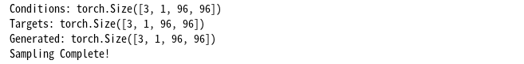
  <figcaption>2026-11-20-23-43-38</figcaption>
</figure>

## 생성결과 비교

이제 결과를 확인해보자. 

- Condition: 입력 약도
- Target: 정답 CAD 도면
- Generated: Conditional DDPM이 생성한 도면

```python
def tensor_to_image(x):

    x = x.detach().cpu()

    x = (x + 1) / 2

    return x.squeeze().numpy().clip(0, 1)


fig, axes = plt.subplots(
    num_samples,
    3,
    figsize=(10, 10)
)

for i in range(num_samples):

    images = [
        conditions[i],
        targets[i],
        generated[i]
    ]

    titles = [
        "Condition",
        "Target CAD",
        "Generated CAD"
    ]

    for j in range(3):

        axes[i, j].imshow(
            tensor_to_image(images[j]),
            cmap="gray",
            vmin=0,
            vmax=1
        )

        axes[i, j].set_title(
            titles[j]
        )

        axes[i, j].axis("off")

plt.tight_layout()
plt.show()
```

<figure>
  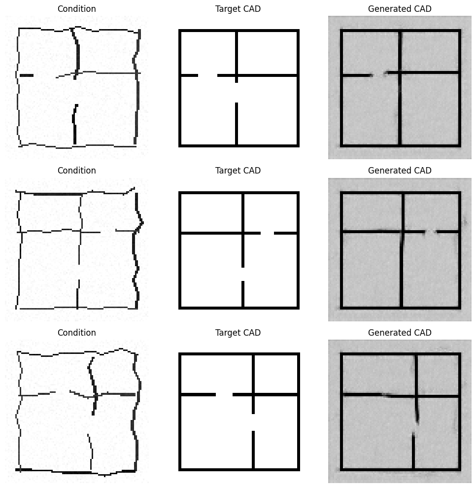
  <figcaption>2026-11-20-23-44-58</figcaption>
</figure>

다음 사항을 확인해보자. 

| 평가 항목 | 확인할 내용 |
|---|---|
| 이미지 생성 | 노이즈에서 평면도 형태가 생성되는가? |
| 외벽 구조 | 외벽이 사각형 형태로 생성되는가? |
| 내부 벽 | 내부 벽의 위치가 유지되는가? |
| 출입구 | 벽의 틈이 적절하게 표현되는가? |
| 직선성 | 삐뚤어진 선이 정돈되는가? |
| 조건 반영 | 서로 다른 약도에서 서로 다른 도면이 생성되는가? |

여기서 마지막 항목이 특히 중요하다.  
이번에는 세 이미지에 동일한 초기 Gaussian Noise와 동일한 단계별 Sampling Noise를 사용했다.  

따라서 모델에 주어지는 확률적 입력은 동일하다.차이가 발생하는 주요 원인은 Condition 이미지다.  

만약 서로 다른 약도를 입력했는데 생성 결과가 거의 동일하다면 모델이 Condition을 충분히 활용하지 못하고 있을 가능성이 있다.  

그러나 생성된 CAD 이미지를 보면 그래도 조금씩은 다 다르다. 그걸 보면 Condition이 어느정도 잘 영향을 주고 있는구나를 알 수 있다. 

## Reverse Diffusion 과정 시각화

이번에는 생성 과정 자체를 관찰하자.

Day 1에서도 Reverse Diffusion을 수행했지만, 이번에는 Condition 이미지가 생성 과정에 영향을 준다.

우리가 저장한 snapshots를 사용하자.

```python
# ==========================================
# Reverse Diffusion Visualization
# ==========================================

steps = [
    "initial",
    999,
    750,
    500,
    250,
    100,
    0
]

fig, axes = plt.subplots(
    1,
    len(steps),
    figsize=(18, 3.5)
)

for ax, step in zip(axes, steps):

    image = snapshots[step]

    ax.imshow(
        tensor_to_image(image),
        cmap="gray",
        vmin=0,
        vmax=1
    )

    if step == "initial":

        ax.set_title("Initial Noise")

    else:

        ax.set_title(f"After t={step}")

    ax.axis("off")

plt.tight_layout()
plt.show()
```
<figure>
  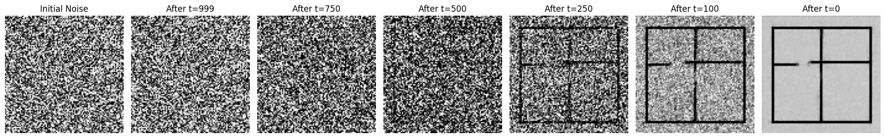
  <figcaption>2026-11-20-23-48-22</figcaption>
</figure>


어떻게, 생각한 되로 잘 되었는가? 

# 결과 고찰

## Condition이 정말 영향을 주는가?

하지만 Conditional U-Net이 실제로 \(c\)를 유용하게 활용하는지는 검증해야 한다.  
그 방법은 앞서 챕터에서 한번 다룬 바 있다.  

```python
same_noise_across_batch=True
```
코드상에 옵션으로 구현되어있을 것이다. 
이런 것을 통해 정말 영향을 주었는지 확인해야 한다. 

## 학습이 잘 되었는데 결과가 이상하다면?

Loss가 감소했다고 해도 좋은 도면이 생성된다는 보장은 없다.

이유를 살펴보자.

### Noise Prediction과 Image Generation은 다르다
학습한 모델은 다음과 같다. 
$$
\epsilon_\theta(x_t,t,c)\approx\epsilon
$$
하지만 마지막 Sampling 실습에서는 예측한 노이즈를 1,000번 반복적으로 사용한다.

따라서 개별 단계의 작은 오차도 생성 과정에서 누적될 수 있다.

또한 학습 중 모델이 접하는 $x_t$는 실제 정답 이미지에서 만들어졌지만, Sampling 중의 $x_t$는 모델이 이전 단계에서 생성한 결과다. 이 차이도 생성 품질에 영향을 줄 수 있다.

### 학습 데이터가 단순하다
이번 데이터셋은 다음과 같은 구조를 가지고 있다.
- 정사각형 외벽
- 세로 내부 벽
- 가로 내부 벽
- 일부가 끊긴 출입구
모델은 이런 이미지의 분포를 학습했습니다.

따라서 일반적인 건축 평면도를 생성하도록 학습된 것은 아니다.

현재 결과를 평가할 때는 합성 데이터에서 조건부 생성이 가능해졌는가를 먼저 확인해야 한다.


### 조건부 생성에 충분한 학습이 이루어지지 않았을 수 있다
20 Epoch는 초기 실험을 위한 설정이다.

모델이 노이즈를 제거하는 능력은 학습했더라도 입력 약도와 정답 도면의 관계를 충분히 학습하지 못했을 수 있다.

따라서 다음과 같은 상황도 발생할 수 있다.

| 결과 | 가능한 원인 |
|---|---|
| 계속 노이즈 형태로 출력 | 학습 부족 또는 Sampling 구현 문제 |
| 모든 결과가 비슷한 도면 | 조건 정보 활용 부족 |
| 외벽만 생성 | 단순한 공통 구조에 치중 |
| 내부 벽의 위치가 잘못됨 | 구조적 조건 반영 부족 |
| 선이 흐릿하거나 깨짐 | 학습 부족 또는 모델 표현력 한계 |

이 경우 단순히 Epoch를 증가시키는 것뿐 아니라 Condition 활용 여부와 데이터 구성을 함께 점검해야 한다. 


# 마무리

> Conditional Diffusion은 정답 이미지를 직접 복사하는 모델이 아니다

우리가 학습한 것은 다음 조건부 분포다.

$$
\boxed{p_\theta(x_0|c)}
$$

즉, 입력 약도가 주어졌을 때 가능한 CAD 스타일 이미지의 분포를 모델링한다.

따라서 같은 약도를 입력해도 초기 노이즈나 Sampling Noise가 달라지면 서로 다른 결과가 나올 수 있다.

> Condition은 Reverse Process 전체에서 사용된다

모델은 다음과 같이 작동합니다.
$$
\boxed{
p_\theta(x_{t-1}|x_t,c)
}
$$

여기서 $c$ 는 모든 timestep에서 동일하다.

이 덕분에 생성 과정 전체가 입력 약도를 조건으로 진행된다.

> DDPM은 반복적인 이미지 생성 모델이다

일반적인 CNN 기반 Image-to-Image 모델이라면 다음처럼 표현할 수 있다.

$$
x_{\mathrm{CAD}}=f_\theta(x_{\mathrm{Sketch}})
$$

하지만 Conditional DDPM은 다음과 같다.

$$
x_{\mathrm{CAD}} = G_\theta(z,x_{\mathrm{Sketch}})
$$

여기서 $z$ 는 초기 Gaussian Noise이며, 실제 Sampling에는 각 단계에서 추가되는 확률적 노이즈도 관여할 수 있다.

이러한 확률적 생성 과정이 일반적인 결정론적 이미지 변환 CNN과의 중요한 차이점이다.

# 참고자료

오늘 실습에 활용한 내용들의 원전이 되는 논문들이다. 시간이 될때 한번 읽어보자. 

## ① DDPM (2020)

Denoising Diffusion Probabilistic Models
- 저자: Jonathan Ho et al.
- 논문: https://arxiv.org/abs/2006.11239
- Day 1과 Day 2의 기본 수학적 토대


## ② SR3 (2021)
Image Super-Resolution via Iterative Refinement
- 저자: Chitwan Saharia et al.
- 논문: https://arxiv.org/abs/2104.07636
- 조건 이미지와 노이즈 이미지를 함께 사용하는 Conditional U-Net
- Day 2 모델 구현의 핵심 참고 논문

## ③ Palette (2022)
Palette: Image-to-Image Diffusion Models
- 저자: Chitwan Saharia et al.
- 논문: https://arxiv.org/abs/2111.05826
- Conditional Diffusion을 다양한 Image-to-Image 변환에 적용
- 우리의 약도 → CAD 스타일 도면 변환과 가장 직접적으로 연결되는 논문