SLAM쪽 분야를 보다보면 몇가지 큰 획이 그어지는게 있는데, 순수하게 알고리즘만을 기준으로 해본다면  첫번째는 칼만필터/파티클 필터가 들어온 순간이고(이게 사실 태동이지만), 그 이후 큰 줄기의 변화는 커지는 맵을 최적화하기 위한 수단인 Graph SLAM이 등장한 것을 꼽을 수 있다. 개인적인 감상으론 이 후 3D Graphics가 접목되고, 이후 Deeplearning으로 이어지는 순이다. 

이번엔 이중에서 Graph SLAM에 대해, 특히 그 중 Optimizer에 대해 실습해보고자 한다.   


# 들어가면서. 

Graph SLAM. 왜 Graph라는 말을 쓰는가 알아보려면, Graph theory에 대해 간단히 알아보면 된다. 뭐 이번 단락은 알면 좋은 상식선으로 이해하면 좋다. 

그래프 이론(Graph theory)는 객체들간에 연결관계를 그래프로 표현하는 이산 수학의 일종이다. 뭐 위키나 이런 것들을 찾아보면 오일러의 퀘니스베르그 다리 문제(그 유명한 한붓그리기 문제 맞다)를 시작으로 설명하곤 한다. 

<figure>
  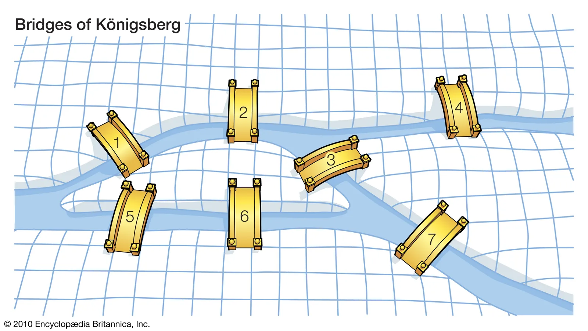
  <figcaption>2026-11-09-14-18-57</figcaption>
</figure>

<figure>
  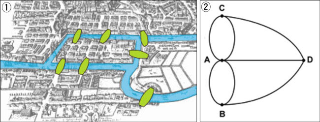
  <figcaption>지금 이 다리 문제는 해결되었다. 2차세계대전때 폭격을 맞아 다리 몇개가 무너지는 바람에...</figcaption>
</figure>

이것이 컴퓨터과학으로 들어와 최단거리 찾기 알고리즘으로 제안된게 그 유명한 다익스트라(Dijkstra) 알고리즘이다. 최초의 논문은 1959년 발표된 3페이지 논문 "A Note on Two problem  in Connexion with Graphs"다 그저 일반 상식으로 넘어가자. 

<figure>
  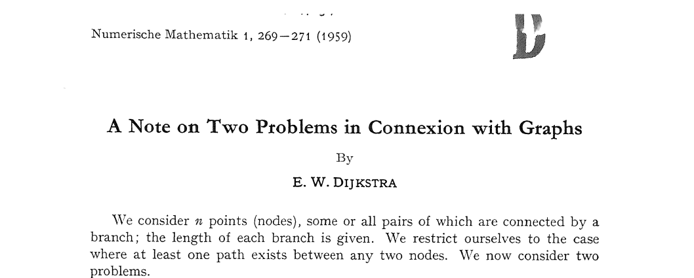
  <figcaption>2026-11-09-14-22-58</figcaption>
</figure>

이것을 시작으로 cost와 Hueristic 추정을 더하여 그 유명한 A* 알고리즘도 나오고 이후 게임등에 널리 이용되게 된다. ("A Formal Basis for the Heuristic Determination of Minimum Cost Paths",1968년,  Peter E. Hart, Nils J. Nilsson, Bertram Raphael )

<figure>
  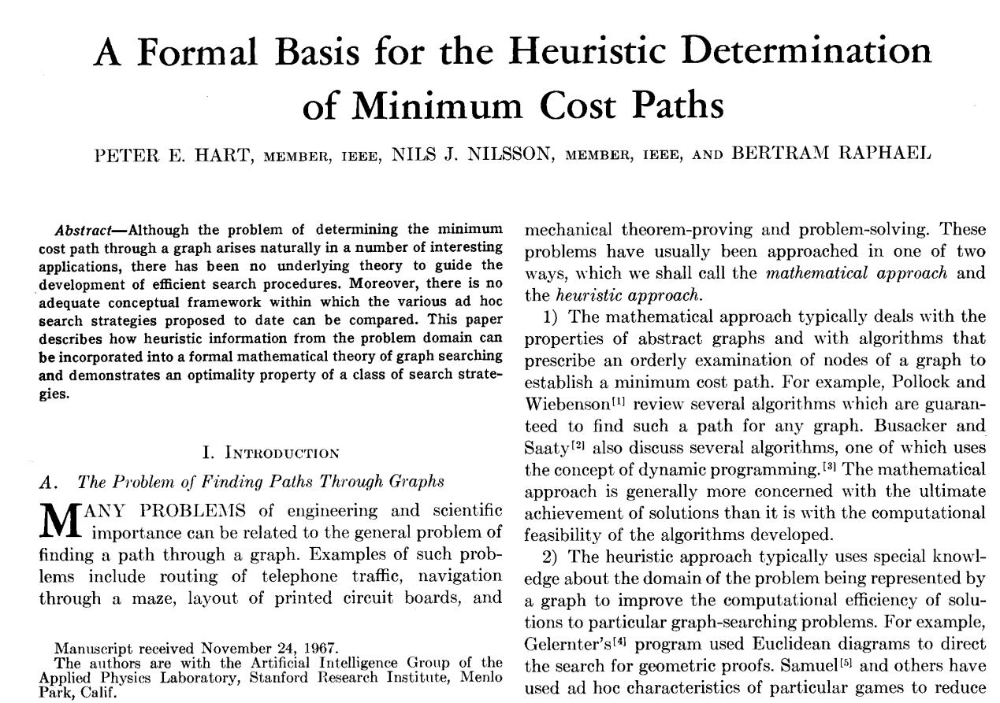
  <figcaption>2026-11-09-14-28-26</figcaption>
</figure>

이후, 자료구조라던가, 컴퓨터공학, 게임등에서 잘 활용되었으나 SLAM 에 직접적으로 연관된건 2006년 "The GraphSLAM Algorithm with Applications to Large-Scale Mapping of Urban Structures" 논문이다. 그 유명한 세바스티안 쓰런(Thrun)교수가 1저자인 논문이다.

<figure>
  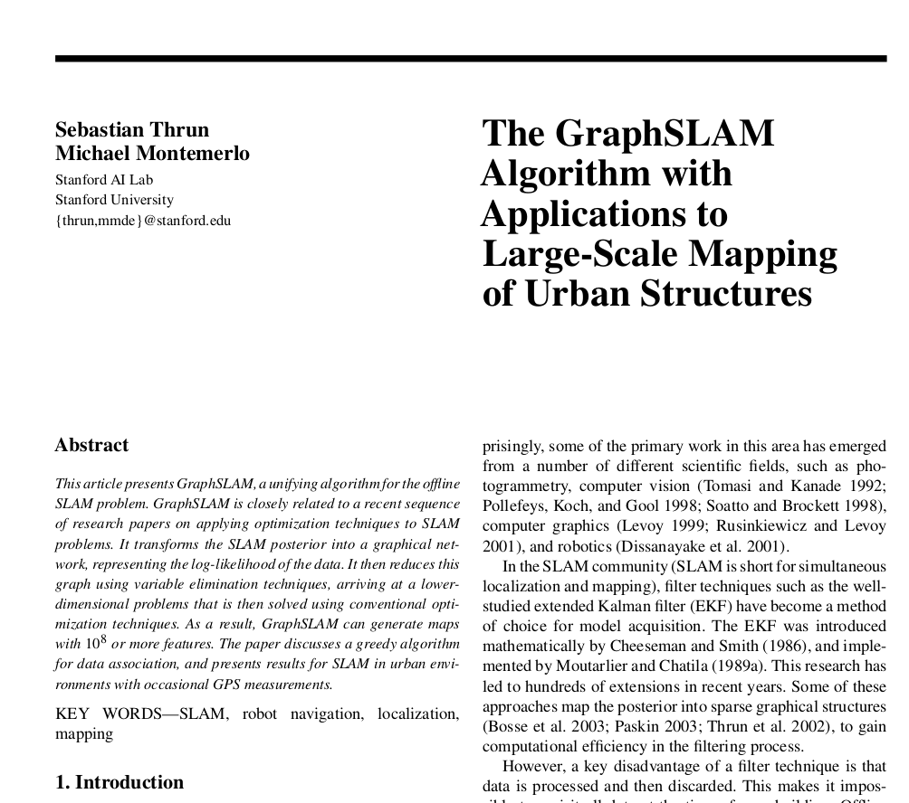
  <figcaption>2026-11-09-14-34-33</figcaption>
</figure>

<figure>
  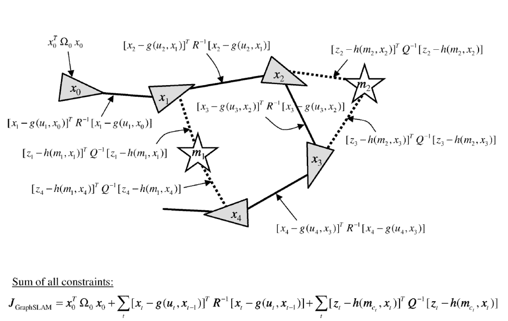
  <figcaption>2026-11-09-14-38-54</figcaption>
</figure>

이후 가장 많이 인용된건 사실 "A Tutorial on Graph-based SLAM"일 것이다. 여기도 유명인사들이 많이 등장한다. 

<figure>
  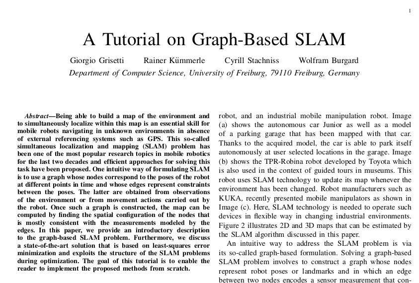
  <figcaption>2026-11-09-14-39-23</figcaption>
</figure>

<figure>
  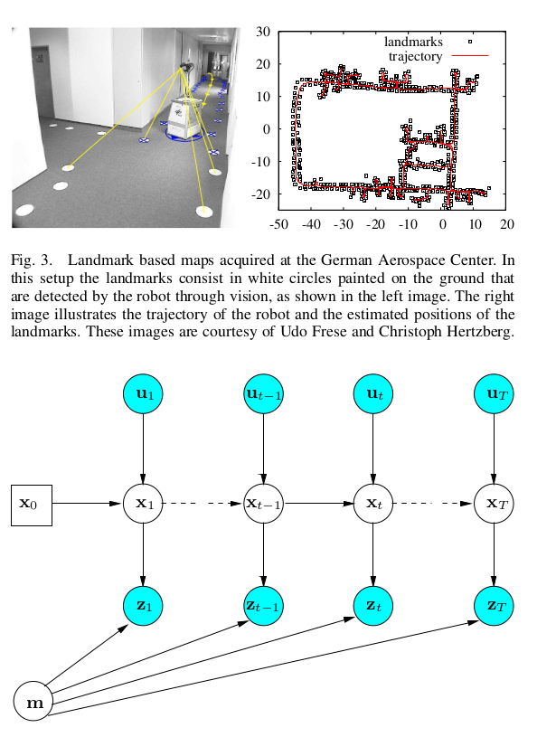
  <figcaption>2026-11-09-14-40-02</figcaption>
</figure>

이런 Graph SLAM들이 예전엔 C++로 열심히 계산해서 최적화를 수행하던 것이... 세상 좋아져서 이제 라이브러리로 등장하게 된다. 그게 GTSAM이다. 

<br>
<br>

# GTSAM의 탄생

2000년대 초반 SLAM연구는 대부분 칼만 필터를 중심으로 이루어졌다. 로봇의 현재 상태를 추정하고, 새로운 센서 정보가 들어오면 그 추정값을 갱신하는 방식으로 진행되었다. 문제는 로봇이 이동하는 거리가 길어지고, 추정값과 관측값이 많아지면서 발생한다. 메모리가 부족해지고, 오차가 누적되어 Drift라는 현상이 발생하게 된다. 이걸 해결하기 위해 Loop Closure 를 적용하여, 여기가 동일 위치임을 확인하고 오차를 수정하는 과정을 거친다.(전문가들은 오차를 털어낸다고 자주 표현한다.) 그런다고 단순히 지금 관측한 pose를 과거 pose에 덮어씌운다거나, 그 반대로 가져올 수도 없다. 이때 선택하는 것이 지금까지 지나온 전체 경로를 다시 조정해 모순을 없애는 과정을 거친다. 이것이 Smoothing이다. 

Smoothing의 방법에는 과거부터 여러가지들이 시도되었다. 전체 데이터를 한번에 최적화 하던 Square Root SAM에서, 이전 계산값을 재사용하고, 영향을 받는 일부 행렬 엔트리만 선별적으로 업데이트 하는 iSAM의 등장, 2011년 등장한 g2o, 그리고 SfM 등에서 쓰인 범용 비선형 최적화 툴인 Ceres Solver있었다. 

그러다 2012년, 조지아텍의 프랭크 델라아트 교수팀(여기도 유명하다)에서  Factor Graph 최적화 툴을 발표한다. 그게 GTSAM이다. 뭔가 거대한 약자 같지만... 풀어쓰면 Georgia Tech Smoothing and Mapping이다. 이걸 알았을때 좀 허무했달까. 하여간 지금 현재 버전은 4.3으로, 2012년 ICRA에서 2.0이 발표된 이래 iSAM2가 통합되고, Visual SLAM, VIO를 지원하며, IMU Preintegration 지원등을 거쳐 지금의 4.3이 나왔다. 현재 버전은 2026년 9월에 나온 버전이며, GPU를 사용할 수 있도록 확장된것이 특징이다. 4.3에서 추가된 여러 특징들이 있는데, 이제 파이썬도 지원한다. (두둥)

상세한 페이지는 공식홈페이지 [gtsam.org](http://gtsam.org) 에서 확인할 수 있다. 

<figure>
  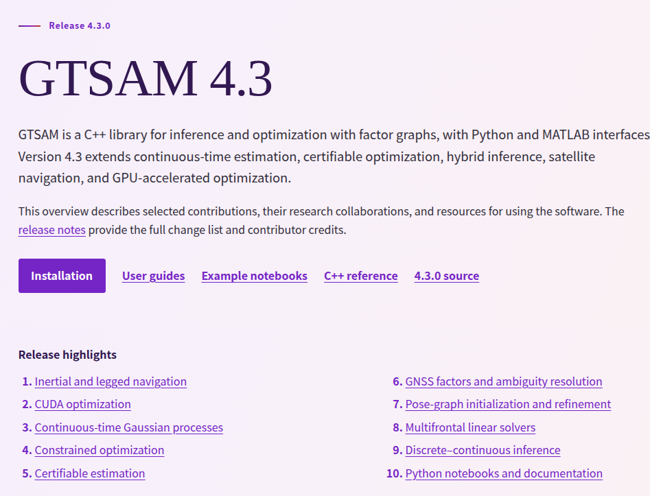
  <figcaption>2026-11-09-15-17-05</figcaption>
</figure>


잡설은 여기까지하고, 본격적으로 오늘의 학습과정에 들어가보도록 한다. 


# 학습/실습의 방향

이번엔 짧게 훅훅 지나가려 한다. 사용법을 익혀서 시스템에 탑재하는 것이 목표지, GTSAM을 개발하자는건 아니니까. 
전체 학습의 방향은 다음과 같다. 

- 목표: g2o와 GTSAM의 기본 사용법을 빠르게 습득
- 언어: Python과 C++ 모두 실습
- 최종 목표: ROS 기반 SLAM 시스템에서 Optimizer가 어떻게 사용되는지 이해

| Part | 주제 | 시간 | 결과물 |
|---|---|---:|---|
| 0 | 환경 구성 | 20분 | Jupyter + GTSAM |
| 1 | SE(2)와 Factor Graph | 25분 | Pose2 연산 이해 |
| 2 | 기본 Pose Graph Optimization | 40분 | 첫 최적화 실행 |
| 3 | Loop Closure Optimization | 60분 | 궤적 보정 실험 |
| 4 | Noise Model 분석 | 30분 | 가중치 변화 분석 |
| 5 | Solver 비교 | 30분 | GN vs LM |
| 6 | 데이터 저장 및 ROS 연계 | 15분 | Day 2용 데이터 |

# 실습환경 설정
일단 간단하게 실습환경을 설정해보자. 
대략 폴더 구조를 다음과 같이 만들어본다. 

```text
slam_optimizer/
    │
    ├── .venv/                # Python 3.11
    │
    ├── notebooks/
    │   ├── 01_gtsam_basics.ipynb
    │   ├── 02_pose_graph.ipynb
    │   ├── 03_loop_closure.ipynb
    │   ├── 04_noise_models.ipynb
    │   └── 05_solver_comparison.ipynb
    │
    ├── data/
    │
    └── cpp/                  # Day 2
```

여기서 살짝쿵 문제가 하나 있는데, GTSAM 4.3은 공식적으로 파이썬 3.11~3.14버전을 지원한다. 따라서, 가상환경을 만들어 파이썬 3.11에서 동작하도록 설정해야 한다. 

<figure>
  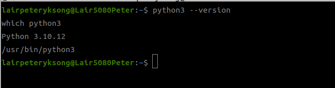
  <figcaption>2026-11-09-16-42-33</figcaption>
</figure>

보시다시피, Ubuntu 22.04 시스템에서는 파이썬 기본 버전이 3.10이다. 

## Python 3.11설치기

앞서 보았던 문제를 해결하기 위해 다음과 같이 진행해본다.   
각자의 환경에 더 적절한게 있다면 그 방법을 따라가도 된다.   
내 경우는 uv를 사용해볼까 한다. uv는 파이썬(Python) 생태계에서 사용되는 고성능 패키지 및 프로젝트 관리 도구라고 한다.  

```bash
curl -LsSf https://astral.sh/uv/install.sh | sh
source ~/.bashrc
uv --version
uv python install 3.11
```

<figure>
  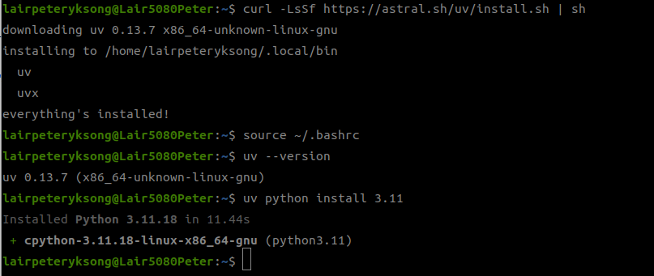
  <figcaption>2026-11-09-16-57-31</figcaption>
</figure>

이렇게 하면, 시스템 python의 버전 변경 없이 `uv`가 관리하는 레이어 위에 파이썬이 설치된다. 

여기서 보이듯, uv에서 관리하는 python과 system파이썬은 다른걸 알수 있다.   
확인 명령은 `uv python list --only-installed` 와 `/usr/bin/python3 --version`이다. 

<figure>
  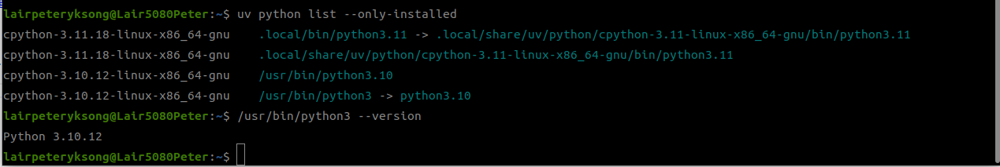
  <figcaption>2026-11-09-16-59-13</figcaption>
</figure>


## 프로젝트 폴더 생성과 가상환경의 설정
앞서서, 프로젝트폴더/에 .venv 폴더를 만들었단걸 기억해보자. 
해당 프로젝트 폴더로 이동해서 다음 스크립트를 실행해보자. 

```bash
uv venv --python 3.11 --managed-python .venv
```
<figure>
  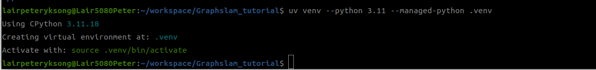
  <figcaption>2026-11-09-17-01-45</figcaption>
</figure>

그러면 다음과 같이 폴더가 생성된다. 

```text

 .venv/
    ├── bin/
    │   ├── python
    │   └── pip (설치 방식에 따라 없을 수 있음)
    ├── lib/
    └── pyvenv.cfg
```

이제 실습에 필요한 패키지를 설치해보자. 

```bash
uv pip install \
    gtsam==4.3.0 \
    numpy \
    scipy \
    matplotlib \
    pandas \
    jupyterlab \
    ipykernel
```

마지막으로 잘 설치되었는지 확인해보자. 
```bash
.venv/bin/python -c "import gtsam; print('GTSAM OK')"
```
<figure>
  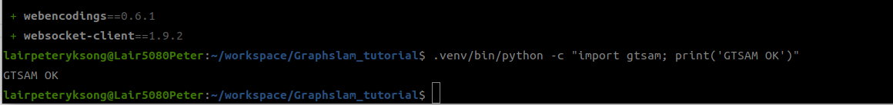
  <figcaption>2026-11-09-17-05-36</figcaption>
</figure>

이제 vscode로 가보자.   

notebooks 폴더 아래에 `01_gtsam_basics.ipynb`를 만들고, 인터프리터를 선택하자. 그냥 할 경우 시스템 파이썬을 따라갈 수 있으니, 각자의 환경에 맞춰 설정하도록ㅎㅏ자. 
화면 우측 상단의 `Select Kernel` 을 눌러서 Python Environment-> 파이썬 3.11버전을 선택한다. 

<figure>
  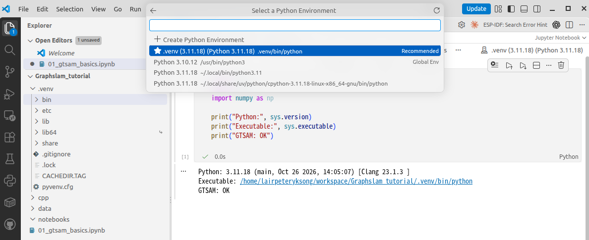
  <figcaption>2026-11-09-17-12-04</figcaption>
</figure>

이후 커널이 잘 선택되었는지 한번 확인해보자. 

```python
import sys
import gtsam
import numpy as np

print("Python:", sys.version)
print("Executable:", sys.executable)
print("GTSAM: OK")
```

<figure>
  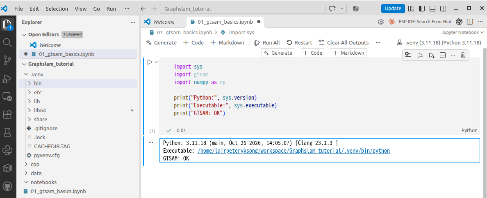
  <figcaption>2026-11-09-17-12-34</figcaption>
</figure>

이렇게 환경설정이 끝났다. 


# 1. GTSAM의 기본 구성 이해

이제 GTSAM을 이용해 SE(2) Pose를 생성하고 상대 변환을 계산해보자. 

## 1 Pose2와 SE(2)

2D 로봇의 Pose는 다음과 같이 표현된다. 

$$
\mathbf{x} =
\begin{bmatrix}
x\\y\\\theta
\end{bmatrix}
$$

벡터로 표현해서 쉬워보이지만, 문제는 Pose의 합성 연산이 단순한 벡터의 덧셈뺄셈이 아니란 것이다. (그랬으면 쉬웠을까)

Pose의 변환은 2D 강체 변환 행렬로 표현되며, 다음과 같은 변환행렬을 사용한다. 

$$
T =
\begin{bmatrix}
\cos\theta & -\sin\theta & x\\
\sin\theta & \cos\theta & y\\
0 & 0 & 1
\end{bmatrix}
$$

이것을 GTSAM에서는 Pose2 객체(instance)로 표현한다. 

이제 주피터 노트북에서 GTSAM을 불러보자. 

```python
import gtsam
import numpy as np
import matplotlib.pyplot as plt

from gtsam.symbol_shorthand import X

print("GTSAM Ready")
```

<figure>
  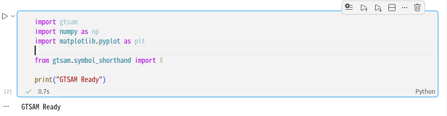
  <figcaption>2026-11-09-17-26-54</figcaption>
</figure>


로봇의 Pose를 생성하자. Pose2 로 선언한다. 

```python
pose0 = gtsam.Pose2(0.0, 0.0, 0.0)

pose1 = gtsam.Pose2(2.0, 1.0, np.pi / 4)

print("Pose0:", pose0)
print("Pose1:", pose1)
```
<figure>
  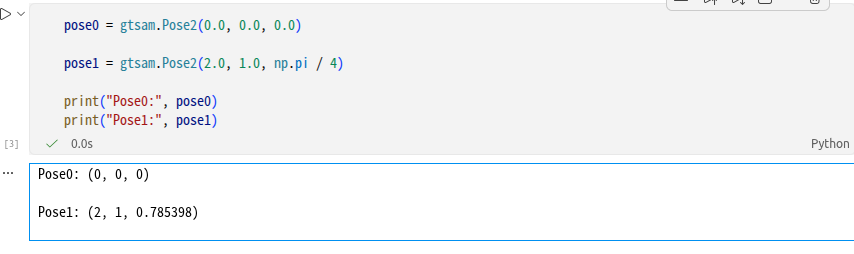
  <figcaption>2026-11-09-17-28-20</figcaption>
</figure>

Pose0 과 Pose1이 만들어졌으므로, 이 두 포즈간의 상대Pose를 계산해보자. 수학적으로는 다음과 같이 표현한다. 

$$
T_{01}=T_0^{-1}T_1
$$

GTSAM에서는 between()이 이 연산을 수행한다.

```python
relative = pose0.between(pose1)

print(relative)
```
<figure>
  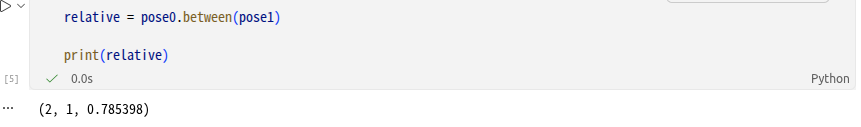
  <figcaption>2026-11-09-17-30-58</figcaption>
</figure>

그러면 Pose의 합성은 어떻게 되는가. 수학적으로 다음이 성립해야 한다. 
$$
T_1=T_0T_{01}
$$
GTSAM에선 compose()함수를 쓴다. 

```python
reconstructed = pose0.compose(relative)

print(reconstructed)
```

그러면 간단한 이해도 테스트. 다음 코드를 보고 로봇은 어떻게 이동했는지 맞춰보자. 
그리고 출력값은 어떻게 되는지도 예측해보자. 

```python
pose0 = gtsam.Pose2(
    0.0,
    0.0,
    np.pi / 2
)

relative = gtsam.Pose2(
    2.0,
    0.0,
    0.0
)

pose1 = pose0.compose(relative)

print(pose1)
```

pose0에 로봇이 90도 각도로 돌려져 세워져 잇다. 여기에 relative 를 결합하여 pose1이 된다(x 방향으로 2만큼 간다). 따라서 pose1 값은 0,2,pi/2가 된다. 헷갈리쥬? 로봇이 90도 회전한 상태에서 로컬 x축 방향으로 2m 이동했기 때문이다. 

<figure>
  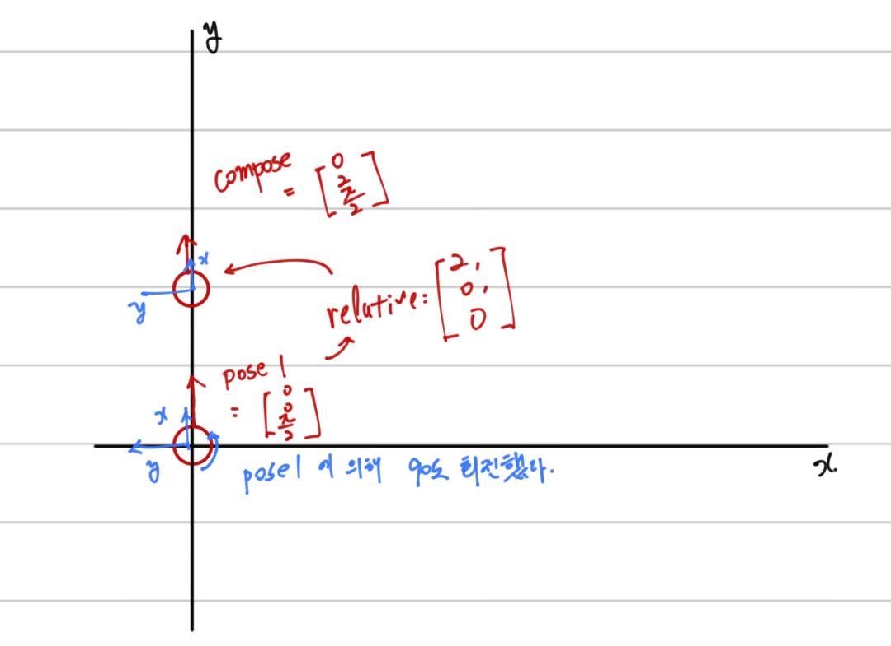
  <figcaption>2026-11-09-18-29-44</figcaption>
</figure>

<figure>
  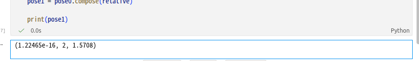
  <figcaption>2026-11-09-17-38-40</figcaption>
</figure>

여기서 또 신기한건 정확한 값이 뜨진 않는다. 근사값이다. 이것은 최적화의 결과라 이해해야 할듯하다. 

이제 실제 최적화를 수행해보자. 


# 2 첫 번째 Pose Graph Optimization

로봇이 직선으로 이동하는 상황을 가정해보자. GT를 다음과 같이 가정해본다. 

- X_0 = (0,0,0)
- X_1 = (2,0,0)
- X_2 = (4,0,0)

그러면 각 Pose 사이의 Odometry측정값은 다음과 같아야 한다. 

- Z_01 = (2,0,0)
- Z_12 = (2,0,0)

이제 이 GT값을 흔들어보자. 오차가 존재한다는 가정을 넣는다. 

$$
X_0^{init}=(0.2,-0.1,0.05)
$$
$$
X_1^{init}=(2.3,0.3,0.1)
$$
$$
X_2^{init}=(4.4,-0.2,-0.1)
$$

이제 목표는 이 추정값들을 보정하는 것이다. 

## 목적함수, Objective function

GTSAM에서 사용하는 Factor Graph의 목적함수는 일반적으로 다음과 같은 형태를 가진다. 
$$
\mathcal{X}^* = \arg\min_{\mathcal{X}} \frac{1}{2} \sum_{k} \| e_k(\mathcal{X}) \|_{\Sigma_k}^2
$$

여기서
$$
\|e\|_{\Sigma}^{2} = e^T\Sigma^{-1}e
$$
이다. 

세 Pose에 대한 목적함수는 개념적으로
$$
E=E_{prior}+E_{01}+E_{12}
$$
로 구성된다. 

Prior Factor는 기준 좌표계를 고정하고, Between Factor는 두 Pose 사이의 상대 변환을 제약한다. 

## Factor Graph의 생성

이제 실습으로 따라가보자. 

## Noise Model
어떻게 노이즈를 발생시킬건지 미리 정한다. 

``` python
import gtsam
import numpy as np

from gtsam.symbol_shorthand import X

graph = gtsam.NonlinearFactorGraph()

#노이즈 모델을 선언한다. 
prior_noise = gtsam.noiseModel.Diagonal.Sigmas(
    np.array([0.01, 0.01, 0.01])
)

odom_noise = gtsam.noiseModel.Diagonal.Sigmas(
    np.array([0.1, 0.1, 0.05])
)
```
Sigmas에 입력하는 값은 분산이 아니라 표준편차입니다.

각 값의 단위는 m, m, rad입니다.

## Prior Factor

기준 Pose $X_0$를 원점 근처에 고정한다. 절대 True. 
```python
graph.add(
    gtsam.PriorFactorPose2(
        X(0),
        gtsam.Pose2(0.0, 0.0, 0.0),
        prior_noise
    )
)
```

## Between Factors
Factor들간의 관계를 정의해보자. 

```
graph.add(
    gtsam.BetweenFactorPose2(
        X(0),
        X(1),
        gtsam.Pose2(2.0, 0.0, 0.0),
        odom_noise
    )
)

graph.add(
    gtsam.BetweenFactorPose2(
        X(1),
        X(2),
        gtsam.Pose2(2.0, 0.0, 0.0),
        odom_noise
    )
)
```
코드를 이해해보면, 0에서 1지점으로, Pose Transform은 (2,0,0)의 관계를 추가한 것이고,   
마찬가지로 1에서 2지점으로 동일한 Transform을 추가한 것이다. 둘다 노이즈 모델은 odom_noise모델을 추종한다. 

```
Prior
  │
  ▼
 X0 ─────── X1 ─────── X2
      Odom       Odom
```
## 초기 추정

어떤 방법을 통해서건 X_1과 X_2를 얻었다고 가정해보자. 
엔코더를 누적했건, 외부 관측을 통해 Visual Odometry를 구했건. 땅바닥에 떨어진 쪽지를 주워서 알게 되었건. 

```python
initial = gtsam.Values()

initial.insert(
    X(0),
    gtsam.Pose2(0.2, -0.1, 0.05)
)

initial.insert(
    X(1),
    gtsam.Pose2(2.3, 0.3, 0.1)
)

initial.insert(
    X(2),
    gtsam.Pose2(4.4, -0.2, -0.1)
)
```
## Optimization

이 초기값을 최적화시켜보자. 사실상 심플하게 한줄이고, 읽기좋게 두줄이다. 

```python
optimizer = gtsam.LevenbergMarquardtOptimizer(
    graph,
    initial
)

result = optimizer.optimize()
```
출력을 해서 한번 확인해보자. 

```python
print("Number of factors:", graph.size())

print("Initial Error:", graph.error(initial))
print("Final Error:", graph.error(result))

for i in range(3):
    pose = result.atPose2(X(i))

    print(
        f"X{i}: "
        f"x={pose.x():.4f}, "
        f"y={pose.y():.4f}, "
        f"theta={pose.theta():.4f}"
    )
```
중간에 따라 실행하다보니 Error 가 좀 많이 튀더랬다. Factor 개수를 체크해보니 3개가 나와야할게 2개만 나오는걸 보고, 다시 따라 올라가 확인해보니 Prior Factor를 빼먹었네.. .하나 빼먹을때마다 값이 많이 달라진다. 

<figure>
  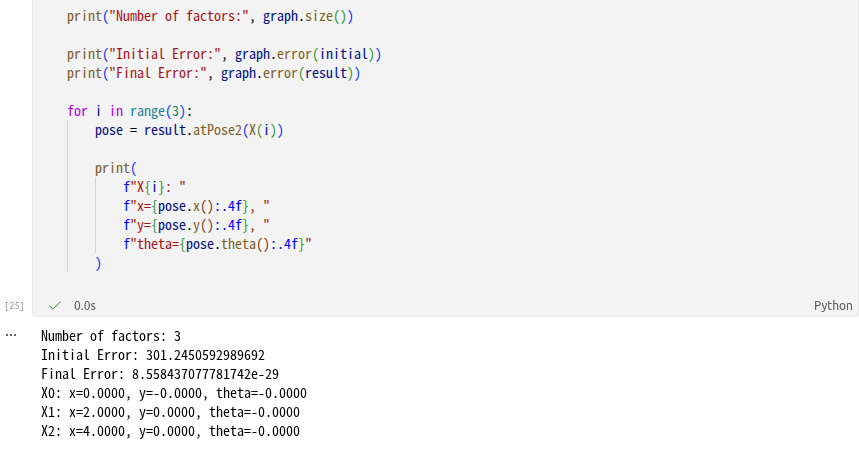
  <figcaption>2026-11-09-19-54-58</figcaption>
</figure>

### Graph Error의 의미

초기 추정치를 넣었고, 여기서 에러를 정의하고, 목적함수를 정의했다.   
수식을 다시 상기해보자.  

$$
\mathcal{X}^* = \arg\min_{\mathcal{X}} \frac{1}{2} \sum_{k} \| e_k(\mathcal{X}) \|_{\Sigma_k}^2
$$


$$
\|e\|_{\Sigma}^{2} = e^T\Sigma^{-1}e
$$
$$
E=E_{prior}+E_{01}+E_{12}
$$

지금이야 우리가 GT값을 알고 있다고 가정하지만, 실제론 GT값을 모르지 않나? 그럼 정확히 에러는 어떻게 정의되는거지?   

여기서 예전에 배웠을법한 칼만필터의 개념이 들어간다. 

$$
e = z - h(x)
$$
z 는 센서로부터 얻은 측정값이고, x는 현재 상태 추정값, 그리고 $h(x)$는 현재 상태에서 예측되는 측정값이 된다. 즉 현재 추정값이 센서측정값과 얼마나 일치하는가를 확인하는 것이다. 

앞서서 Odometry 를 예로 보자. Z01 = (2,0,0)이었다. 즉 Odom 센서는 로봇이 X0에서 X1까지 전방으로 2m이동했다고 측정했다. 그런데 각 지점의 추정값은 다음과 같았다. 

- X0 = (0,0,0)
- X1 = (2.3,0.3,0)

현재 추정값으로 계산한 상대 이동은 
$$
\hat Z_{01}=X_0^{-1}X_1
$$
이므로, 

$$
\hat Z_{01}=(2.3,0.3,0)
$$

이 되어야 한다. 그러나 실제 측정 값 Z01 은 (2,0,0)이므로, 이 차이를 단순하게 표현하면 다음과 같이 표현되는 것이다. 

$$
e_{01}=
\begin{bmatrix}
2.3-2.0\\
0.3-0\\
0-0
\end{bmatrix}
=
\begin{bmatrix}
0.3\\
0.3\\
0
\end{bmatrix}
$$

그런데, 이건 단순히 Factor 하나의 에러이고. 다른 Factor들의 모든 에러를 더해야 한다. 전체 Graph의 Error $E$는 다음과 같다. 

$$
E(\mathcal{X})
=
\frac12
\sum_k
e_k^T\Omega_k e_k
$$

여기서 
$$
\Omega_k=\Sigma_k^{-1}
$$
다. 

앞서 있던 예제를 다시 돌아보자. 

Residual error $e$ 는 구했다. 그럼 $\Sigma$ 는? 표준편차를 이용해서 공분산 행렬을 만든다. 

- $\sigma_x$ =0.1m
- $\sigma_y$ =0.1m
- $\sigma_\theta$ =0.05rad

그러면 표준편차의 제곱항이 들어가야 하니가, 공분산 행렬은 다음과 같다. 

$$
\Sigma=
\begin{bmatrix}
0.01&0&0\\
0&0.01&0\\
0&0&0.0025
\end{bmatrix}
$$

그러면 앞서서 E(x)를 계산하는 식에 Residual과 같이 대입해서 계산해보면, 
$$
e_{01}=
\begin{bmatrix}
0.3\\
0.3\\
0
\end{bmatrix}
$$

$$
E_{01}
=
\frac12
\left(
\frac{0.3^2}{0.1^2}
+
\frac{0.3^2}{0.1^2}
\right)
$$

최종적으로 Error E_01 = 9 라는 값을 가지게 된다. 

그런 식의 연산을 했던 것이 `graph.error()`함수다. 
이걸 LM Optimizer를 써서 최소화 하는 과정을 실습했다. 

주의: Error가 감소했다고 해서 실제 Ground Truth와의 거리까지 반드시 감소하는 것은 아니다. 잘못된 측정값이나 부적절한 Noise Model이 있다면 잘못된 결과를 얻을 수도 있다.

에러에 대한 개념은 일단 여기까지 하고, 이제 챕터를 넘겨 Loop Closure를 들여다보자. 


# 3. Loop Closure를 이용한 Pose Graph Optimization

세번째 파일을 만들자. `03_loop_closure.ipynb`
벌써 절반왔다. 힘내자. 


앞서까지는 간단했다. 1차원에서의 움직임이고, 뭔가 모순된 그래프관계가 없었기때문이다. 
이제 loop closure가 들어가면서 최적화가 꼬일 것이다. 

> 내가 100미터는 온것 같은데 제자리라고?

이런 느낌인거다. 

## 실습 시나리오

로봇은 정사각형의 경로를 따라 이동한다고 가정하자.  
그리고 그 경로상에서 총 17개의 Pose 가 있다고 하자.   
로봇은 X0에서 출발해서 한바퀴 이동하고 X16에서 출발위치로 돌아온다.(Loop closing)

하지만 Odometry Noise가 있기때문에, 단순히 측정값만을 누적해선 경로가 닫히지 않을것이다. 

```
  X12 ◄────── X8
   │           ▲
   │           │
   │           │
   ▼           │
  X16 ─────── X4
  X0
```

| 항목 | 값 |
|---|---|
| Pose 수 | 17 |
| 경로 | 4m × 4m 정사각형 |
| Odometry Edge | 16 |
| Loop Closure Edge | 1 |
| Odometry Noise | Gaussian |
| Prior | X0 |
| Optimizer | Levenberg-Marquardt |

- Ground Truth는 직접 생성하고, 

- Odometry 측정값에는 재현 가능한 Gaussian Noise를 추가한다.

- Loop Closure는 \(X_0\)와 \(X_{16}\) 사이에 설정한다.

## Ground Truth 의 생성

어렵게 생각하지 말자. random이다. 

```python
import gtsam
import numpy as np
import matplotlib.pyplot as plt

from gtsam.symbol_shorthand import X

rng = np.random.default_rng(42)
```

이제 정사각형을 따라가는 경로를 하나 만들자. 

```python
gt_poses = []

# Bottom: (0,0) -> (4,0)
for x in range(4):
    gt_poses.append(gtsam.Pose2(x, 0, 0))

# Right: (4,0) -> (4,4)
for y in range(4):
    gt_poses.append(gtsam.Pose2(4, y, np.pi / 2))

# Top: (4,4) -> (0,4)
for x in range(4, 0, -1):
    gt_poses.append(gtsam.Pose2(x, 4, np.pi))

# Left: (0,4) -> (0,0)
for y in range(4, 0, -1):
    gt_poses.append(gtsam.Pose2(0, y, -np.pi / 2))

# Final pose at starting point
gt_poses.append(gtsam.Pose2(0, 0, 0))
```
어떻게 생겼는지 한번 간단히 시각화 해보자. 

```python
gt_xy = np.array([
    [p.x(), p.y()] for p in gt_poses
])

plt.figure(figsize=(7, 7))

plt.plot(
    gt_xy[:, 0],
    gt_xy[:, 1],
    'g-o',
    label='Ground Truth'
)

plt.axis('equal')
plt.grid(True)
plt.legend()
plt.title("Ground Truth Trajectory")
plt.show()

```

<figure>
  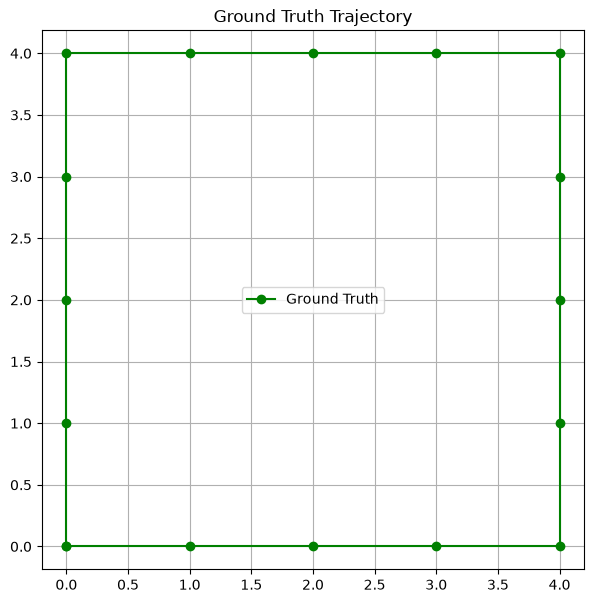
  <figcaption>2026-11-09-21-18-26</figcaption>
</figure>

## Noisy Odometry 생성
실제 Odometry에는 측정 오차가 포함된다.
$$
Z_{ij}
=
Z_{ij}^{true}\oplus\epsilon_{ij}
$$

여기서 $$\oplus$$ 는 Pose 합성에 의한 국소적인 교란을 의미한다. Lie 그룹 연산에서 보던 기호다. 그게 맞는지는 모르겠지만.  
이번 실습에서는 단순화를 위해 Pose2의 로컬 좌표 성분에 독립적인 Gaussian Noise를 추가한다.   
$$
\epsilon_{ij}\sim\mathcal{N}(0,\Sigma)
$$

위의 내용대로 코드를 작성해보자. 

```python
odom_measurements = []

odom_sigmas = np.array([
    0.055,
    0.055,
    0.025
])

for i in range(len(gt_poses) - 1):

    # True relative pose
    true_rel = gt_poses[i].between(gt_poses[i + 1])

    # Gaussian noise
    noise = rng.normal(0, odom_sigmas)

    noise_pose = gtsam.Pose2(
        noise[0],
        noise[1],
        noise[2]
    )

    # Noisy measurement
    measured = true_rel.compose(noise_pose)

    odom_measurements.append(measured)
```

## Odometry Integration
방금 생성한 Odometry 측정값들을 누적하여 초기경로를 한번 표현해보자. 
$$
X_{i+1}^{odom}
=
X_i^{odom}Z_{i,i+1}
$$

```python
odom_poses = [
    gtsam.Pose2(0, 0, 0)
]

for measurement in odom_measurements:

    next_pose = odom_poses[-1].compose(
        measurement
    )

    odom_poses.append(next_pose)
```

이제 노이즈로 인해 생긴 Drift를 한번 시각화해보자. 

```python
odom_xy = np.array([
    [p.x(), p.y()] for p in odom_poses
])

plt.figure(figsize=(8, 7))

plt.plot(
    gt_xy[:, 0],
    gt_xy[:, 1],
    'g-o',
    label='Ground Truth'
)

plt.plot(
    odom_xy[:, 0],
    odom_xy[:, 1],
    'r--o',
    label='Odometry'
)

plt.axis('equal')
plt.grid(True)
plt.legend()
plt.title("Odometry Drift")
plt.show()
```

<figure>
  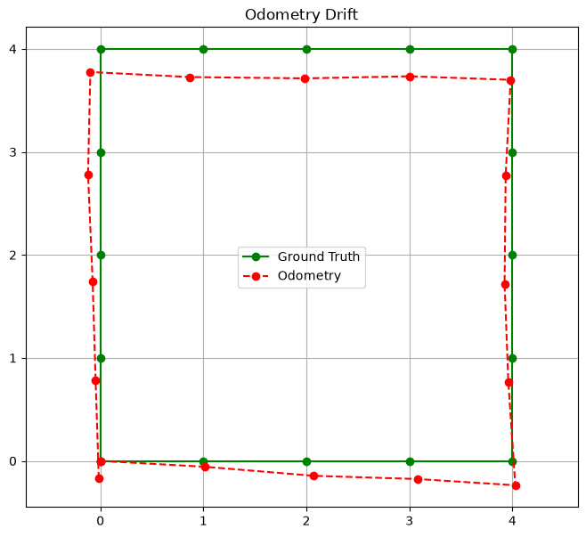
  <figcaption>2026-11-09-21-38-36</figcaption>
</figure>

그림에서 보다시피, 노이즈가 추가되면서 궤적이 왜곡되고, 최종 시작점과 끝점이 닿질 않는다. 

이제 이걸 최적화해보자. 

## Pose Graph 생성

이제 GTSAM으로 Optimizer를 구성해보자. 

 Factor graph를 만든다. 

```python
graph = gtsam.NonlinearFactorGraph()

prior_noise = gtsam.noiseModel.Diagonal.Sigmas(
    np.array([0.001, 0.001, 0.001])
)

odom_noise = gtsam.noiseModel.Diagonal.Sigmas(
    odom_sigmas
)

loop_sigmas = np.array([0.03, 0.03, 0.02])

loop_noise = gtsam.noiseModel.Diagonal.Sigmas(
    loop_sigmas
)
```

노이즈 모델이 선언되었으면, Prior를 추가한다. 

```python
graph.add(
    gtsam.PriorFactorPose2(
        X(0),
        gt_poses[0],
        prior_noise
    )
)
```

Odometry Factors도 추가해보자. 

```python
for i, measurement in enumerate(odom_measurements):

    graph.add(
        gtsam.BetweenFactorPose2(
            X(i),
            X(i + 1),
            measurement,
            odom_noise
        )
    )
```

이제 초기 추정치도 넣어보자. 
```python
initial = gtsam.Values()

for i, pose in enumerate(odom_poses):

    initial.insert(
        X(i),
        pose
    )
```

## Loop closure의 추가
이 챕터의 하이라이트다. 시작 Pose와 마지막 Pose가 동일한 장소라는 정보를 추가한다. 
$$
X_0^{-1}X_{16}\approx I
$$

실습에서는 Loop Closure 측정값에도 작은 Noise를 추가한다. 

```python
true_loop = gt_poses[0].between(
    gt_poses[-1]
)

loop_noise_sample = rng.normal(
    0,
    loop_sigmas
)

loop_measurement = true_loop.compose(
    gtsam.Pose2(*loop_noise_sample)
)

graph.add(
    gtsam.BetweenFactorPose2(
        X(0),
        X(16),
        loop_measurement,
        loop_noise
    )
)
```

검산 작업을 위해 몇개의 Factor가 있는지 확인해보자. 
```
print("Number of factors:", graph.size())
```
이제 Graph에는 총 18개의 Factor가 존재한다.
- Prior: 1개
- Odometry: 16개
- Loop Closure: 1개

## 최적화 실행

이제 최적화를 실행해보자. 

```python
optimizer = gtsam.LevenbergMarquardtOptimizer(
    graph,
    initial
)

result = optimizer.optimize()

print("Initial Error:", graph.error(initial))
print("Final Error:", graph.error(result))
```
<figure>
  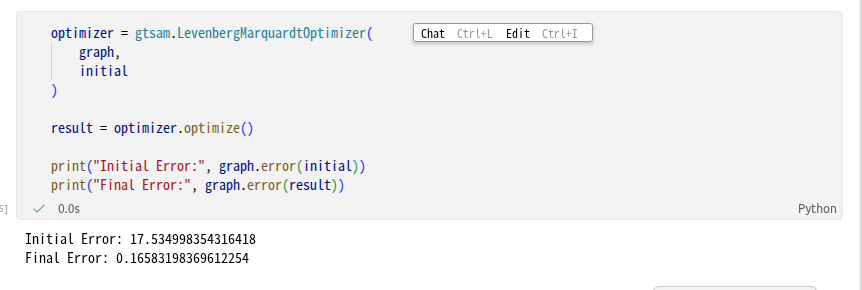
  <figcaption>2026-11-09-21-47-49</figcaption>
</figure>

최적화 된 경로를 리스트로 저장해서 시각화에 활용해보자. 

```python
opt_poses = [
    result.atPose2(X(i))
    for i in range(len(gt_poses))
]

opt_xy = np.array([
    [p.x(), p.y()] for p in opt_poses
])
```

## 시각화

이제 최적화된 결과를 시각화 해보자. 

```python
plt.figure(figsize=(9, 8))

plt.plot(
    gt_xy[:, 0],
    gt_xy[:, 1],
    'g-o',
    label='Ground Truth'
)

plt.plot(
    odom_xy[:, 0],
    odom_xy[:, 1],
    'r--o',
    label='Odometry'
)

plt.plot(
    opt_xy[:, 0],
    opt_xy[:, 1],
    'b-o',
    label='Optimized'
)

plt.axis('equal')
plt.grid(True)
plt.legend()

plt.xlabel("X [m]")
plt.ylabel("Y [m]")

plt.title("GTSAM Pose Graph Optimization")

plt.show()
```

<figure>
  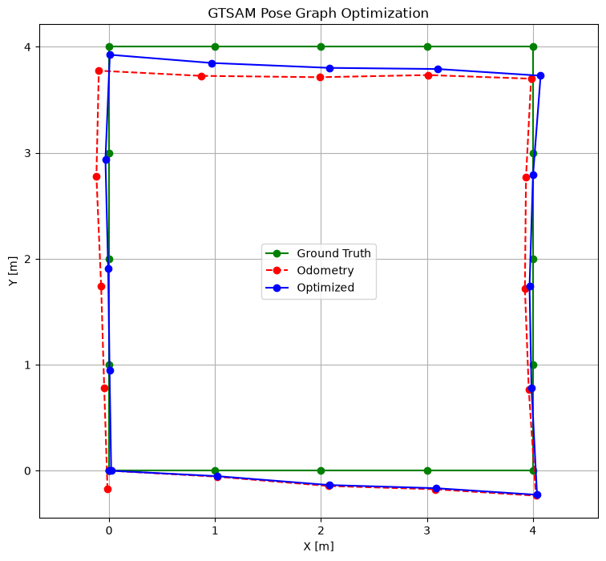
  <figcaption>2026-11-09-21-49-07</figcaption>
</figure>

결과를 놓고 돌아보자. 

Loop Closure가 추가되면 전체 경로가 보정된다.

특히 마지막 Pose가 시작 Pose와 가까워지도록 전체 Pose가 재조정된다.

다만 Loop Closure 자체에도 Noise가 있기 때문에 최적화된 두 Pose가 완벽하게 일치할 필요는 없다.

또한 Ground Truth와 Optimized Trajectory가 항상 동일한 것은 아니다.

Optimizer의 목표는 Ground Truth를 복원하는 것이 아니라, 입력한 측정값과 Noise Model에 기반한 전체 목적함수를 최소화하는 것.

요기까지가 Loop Closure에서 돌아볼만하다. 

Loop Closure를 정의하는 것도 어렵지가 않다.   
Loop가 감지되면, 두 Pose간에 graph node만 연결하면된다. 

```python
graph.add(
    gtsam.BetweenFactorPose2(
        X(0),
        X(16),
        loop_measurement,
        loop_noise
    )
```
만약 이상적으로 loop가 만났다면, 측정값은 단위행렬이 되겠다. 


$$
Z_{0,16}^{true}=
\begin{bmatrix}
1&0&0\\
0&1&0\\
0&0&1
\end{bmatrix}
$$

# 4. 노이즈 모델에 대한 고찰

`03_loop_closure.ipynb` 파일을 복사해서 `04_noise_models.ipynb`로 만들자. 
실험할때 앞에있는것들 다 재활용하려 한다. 

이번 단계에서는 측정값의 신뢰도가 최적화 결과에 어떤 영향을 미치는지 확인한다.

## Noise Model의 수학적 의미

앞서 에러를 정의했던 수식을 다시 가져와본다. 

$$
E_k= \frac12 e_k^T\Sigma_k^{-1}e_k
$$

그리고 공분산이 대각행렬이라 가정한다면(실제는 대각행렬이 아니란 소리겠구나), 

$$
\Sigma=
\begin{bmatrix}
\sigma_x^2&0&0\\
0&\sigma_y^2&0\\
0&0&\sigma_\theta^2
\end{bmatrix}
$$

이에 따라 식을 전개해보면 최종 Error는 다음과 같다. 

$$
E_k=
\frac12
\left(
\frac{e_x^2}{\sigma_x^2}
+
\frac{e_y^2}{\sigma_y^2}
+
\frac{e_\theta^2}{\sigma_\theta^2}
\right)
$$

수식을 통해서 알수 있지만, 표준편차가 작을수록 해당 측정값의 오차에 더 큰 페널티가 온다.

## 실험설정

이제 그 공분산의 힘을 느껴보자. Loop closure의 신뢰도를 변경해본다.


| 실험 | Loop Closure σx, σy | σθ |
|---|---:|---:|
| A | 0.01m | 0.01rad |
| B | 0.1m | 0.1rad |
| C | 1.0m | 1.0rad |

A는 Loop Closure를 매우 신뢰하는 경우다.

C는 Loop Closure를 상대적으로 신뢰하지 않는 경우다.

단, 표준편차를 변경한다는 것은 실제 데이터의 측정값을 바꾸는 것이 아니라, Optimizer가 측정값을 얼마나 신뢰하는지를 변경한다는 의미로 보면 좋다.

## 실험코드

Part 3에서 생성한 odom_measurements, odom_noise, initial, loop_measurement를 그대로 사용한다.

```python
def optimize_with_loop_sigma(sigma):

    test_graph = gtsam.NonlinearFactorGraph()

    test_graph.add(
        gtsam.PriorFactorPose2(
            X(0),
            gt_poses[0],
            prior_noise
        )
    )

    for i, measurement in enumerate(odom_measurements):

        test_graph.add(
            gtsam.BetweenFactorPose2(
                X(i),
                X(i + 1),
                measurement,
                odom_noise
            )
        )

    test_loop_noise = gtsam.noiseModel.Diagonal.Sigmas(
        np.array([sigma, sigma, sigma])
    )

    test_graph.add(
        gtsam.BetweenFactorPose2(
            X(0),
            X(16),
            loop_measurement,
            test_loop_noise
        )
    )

    optimizer = gtsam.LevenbergMarquardtOptimizer(
        test_graph,
        initial
    )

    return optimizer.optimize()
```

옵티마이저를 새롭게 정의했으면 이제 시그마를 바꿔가며 실험해보자. 

```python
sigmas = [0.01, 0.1, 1.0]

results = {}

for sigma in sigmas:
    results[sigma] = optimize_with_loop_sigma(sigma)
```

결과를 시각화해보면 이렇다. 

```python
plt.figure(figsize=(9, 8))

plt.plot(
    gt_xy[:, 0],
    gt_xy[:, 1],
    'k--',
    label="Ground Truth"
)

for sigma, res in results.items():

    xy = np.array([
        [
            res.atPose2(X(i)).x(),
            res.atPose2(X(i)).y()
        ]
        for i in range(17)
    ])

    plt.plot(
        xy[:, 0],
        xy[:, 1],
        label=f"Loop Sigma = {sigma}"
    )

plt.axis('equal')
plt.grid(True)
plt.legend()
plt.title("Effect of Loop Closure Noise")
plt.show()
```
<figure>
  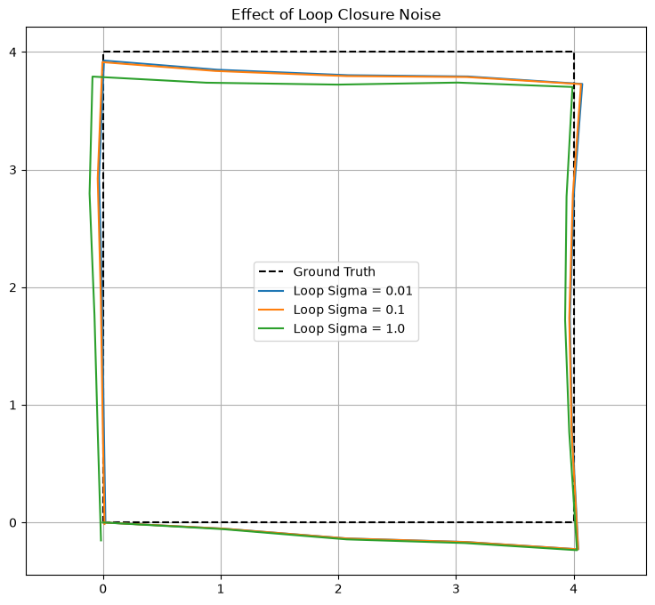
  <figcaption>2026-11-09-23-31-36</figcaption>
</figure>

이제 위의 결과를 놓고, 아래 질문에 한번 답을 해보자. 

Q1. Loop Closure의 표준편차가 작아지면 마지막 Pose는 시작 Pose와 얼마나 가까워지는가?
-> 거의 붙을 정도로 가까워진다. 

Q2. Loop Closure의 표준편차를 크게 설정하면 Odometry의 영향력이 왜 상대적으로 커지는가?
현재의 Odom과 관측값을 바탕으로 한 odom사이의 차이를 $e$로 정의했었다. 그러나 $\sigma$ 가 커지므로 상대적으로 Graph error가 작아지는 결과를 낳아 최적화가 반영되지 않는다. 
따라서 Odom 자체의 영향력이 커지는 결과를 가져온다. 

Q3. Loop Closure 측정값이 잘못되었는데 표준편차를 매우 작게 설정하면 어떤 문제가 발생하는가?
에러의 차이를 너무 크게 반영하여 Overconfidence의 문제가 발생할것 같다. 
예를 들어 실제 로봇이 출발점으로 돌아왔다고 가정하자.
$$
X_0^{GT}=X_{16}^{GT}
$$
그런데 잘못된 Loop Closure 측정값이 다음과 같이 들어왔다.
$$
Z_{0,16}^{LC}=(2.0,0,0)
$$
이는 실제로는 두 Pose가 같은 위치인데, Loop Closure가 2m 떨어져 있다고 잘못 주장하는 상황에서, 표준편차를 매우 작게 설정하게 될 경우
$$
\sigma_{LC}=0.01
$$
그러면 Optimizer는 이 잘못된 측정값을 매우 신뢰하게 되면서, 그 결과 두 Pose 사이의 상대 변환을 2m에 가깝게 만들기 위해 전체 궤적을 왜곡할 수 있다.  
결과를 시각화 한 부분에서도, 최종 goal은 닿았지만 이를 위해 다른 trajectory가 좀더 먼 방향을 부풀어 버린 것을 알 수 있다. 좀더 극적으로 표현하고 싶으면 코드를 약간 더 수정해보자. 


이 실험에서 확인하는 핵심은 **Optimizer의 성능은 Solver뿐 아니라 Factor와 Noise Model을 어떻게 구성하는지에 크게 좌우된다** 는 것이다. 잘 기억하자. 


# 5. Solver의 역할, Gauss-Newton vs Levenberg-Marquardt

03_loop_closure.ipynb 을 복사해서 이어가자. 파일 이름은 05_solver_comparison.ipynb다. 

GTSAM에서는 크게 두가지 Optimizer를 사용한다. 하나는 Gauss Newton이고, 또하나는 Levenberg-Marquardt다. 줄여서, GN 또는 LM 이렇게 부르는가보다. 아... 이거 예전에 수식 배웠었는데...

## Gauss-Newton
비선형 Residual을 현재 추정값 근처에서 선형화한다. 오..설명 깔끔하네. 
$$
e(x+\Delta x)  \approx  e(x)+J\Delta x
$$

J 는 자코비안(Jacobian)이다. 

Factor Graph는 최적화 문제를 표현하는 구조이고, 가중 최소제곱(weighted-Least-Square, 줄여서 WLS)은 그 Factor Graph에서 정의한 오차를 최소화하는 수학적 문제다.  WLS 문제의 일반식은 Hessian을 사용한다. 그 가중치가 $\frac{1}{\sigma^2}$이고, 이 분자에 에러를 곱하면 $\frac{e}{\sigma^2}$ 이 형태가 된다. 이걸 누적하면 앞서 언급했던 목적함수(Objective Function)이 된다. 

주석 : 가중 최소제곱법(Weighted Least Squares, WLS)은 일반적인 최소제곱법(OLS)의 가정인 '모든 잔차의 분산이 같다(등분산성)'가 깨졌을 때, 관측치마다 다른 가중치를 부여하여 회귀 계수를 추정하는 방법이다. 

$$
H\Delta x = -g
$$

$$
H=J^T\Omega J
$$

$$
g=J^T\Omega e
$$

로 정의된다. 

이런 지식을 토대로, GN에서는 다음 과정을 반복한다. 

```
Initial Estimate
       │
       ▼
Residual 계산
       │
       ▼
Jacobian 계산
       │
       ▼
Linear System 구성
       │
       ▼
H Δx = -g
       │
       ▼
State 업데이트
       │
       ▼
Convergence 검사
```

## Levenberg-Marquardt

LM은 Gauss-Newton에 Damping을 추가한다. 대표적인 형태는 다음과 같다. 

$$ 
(H+\lambda I ) \Delta x = - g
$$

실제 GTSAM 구현에서는 Damping 설정에 따라 대각 성분을 활용하는 형태 등이 사용될 수 있다.

$\lambda$ 가 작으면 Gauss-Newton과 비슷하게 동작하고, 반대로 $\lambda$ 가 크면 더 보수적인 업데이트를 수행한다. 

LM은 초기 추정값이 좋지 않은 상황에서 GN보다 안정적으로 동작하는 경우가 많다. 다만 항상 더 빠르거나 더 좋은 최솟값을 찾는 것은 아니다.

## 두 Solver 실행

앞서서 이야기했듯, part 3 실습파일에서 이어가자. (03_loop_closure.ipynb)

```python
gn_optimizer = gtsam.GaussNewtonOptimizer(
    graph,
    initial
)

gn_result = gn_optimizer.optimize()

print(
    "GN Error:",
    graph.error(gn_result)
)
lm_optimizer = gtsam.LevenbergMarquardtOptimizer(
    graph,
    initial
)

lm_result = lm_optimizer.optimize()

print(
    "LM Error:",
    graph.error(lm_result)
)
```

<figure>
  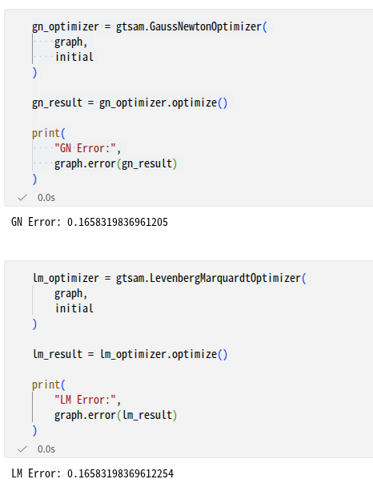
  <figcaption>2026-11-10-00-50-18</figcaption>
</figure>

데이터가 많거나 어렵지 않아서 오차가 비슷하게 나온다. 이를 시각화 해봐도 거의 비슷하단걸 알 수 있다. 

```python
gn_xy = np.array([
    [
        gn_result.atPose2(X(i)).x(),
        gn_result.atPose2(X(i)).y()
    ]
    for i in range(17)
])

lm_xy = np.array([
    [
        lm_result.atPose2(X(i)).x(),
        lm_result.atPose2(X(i)).y()
    ]
    for i in range(17)
])

plt.figure(figsize=(9, 8))

plt.plot(
    gn_xy[:, 0],
    gn_xy[:, 1],
    'r--',
    label='Gauss-Newton'
)

plt.plot(
    lm_xy[:, 0],
    lm_xy[:, 1],
    'b-',
    label='Levenberg-Marquardt'
)

plt.axis('equal')
plt.grid(True)
plt.legend()
plt.title("GN vs LM")
plt.show()
```
<figure>
  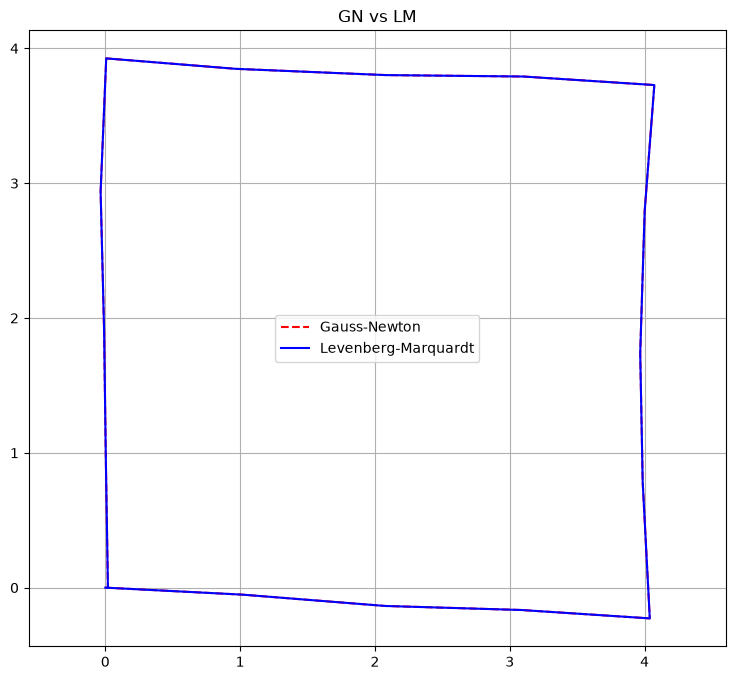
  <figcaption>2026-11-10-00-51-02</figcaption>
</figure>

결과적으로 놓고 보면 어떤 옵티마이저를 선택해도 최종 에러는 비슷하게 수렴한다는걸 알 수 있다. 

중간에 초기추정치를 아주 엉망진창으로 만들어도, 생각보다 잘 수렴한다. 

```python

rng_bad = np.random.default_rng(123)

very_bad_initial = gtsam.Values()

for i in range(len(gt_poses)):

    pose = initial.atPose2(X(i))

    dx = rng_bad.normal(0, 2.0)
    dy = rng_bad.normal(0, 2.0)
    dtheta = rng_bad.normal(0, 0.8)

    very_bad_initial.insert(
        X(i),
        gtsam.Pose2(
            pose.x() + dx,
            pose.y() + dy,
            pose.theta() + dtheta
        )
    )

print(
    "Initial Error:",
    graph.error(bad_initial)
)

gn_optimizer = gtsam.GaussNewtonOptimizer(
    graph,
    very_bad_initial  #요거 수정해야 한다. 
)

gn_result = gn_optimizer.optimize()

print(
    "GN Error:",
    graph.error(gn_result)
)

lm_optimizer = gtsam.LevenbergMarquardtOptimizer(
    graph,
    bad_initial
)

lm_result = lm_optimizer.optimize()

print(
    "LM Error:",
    graph.error(lm_result)
)
```
<figure>
  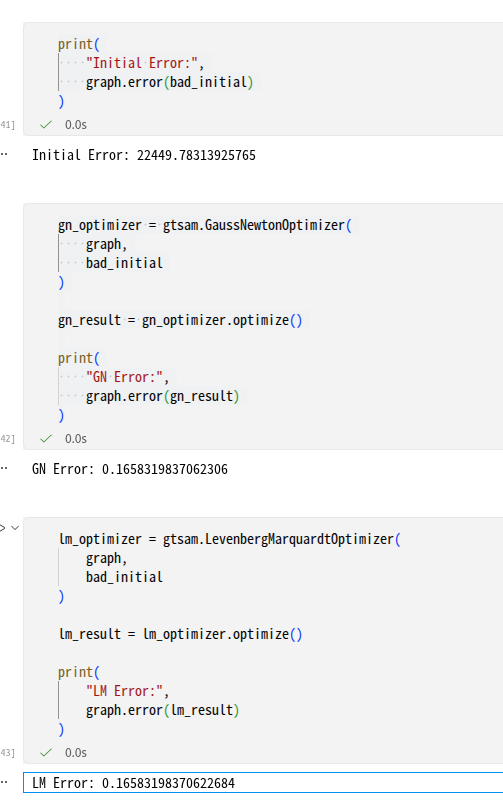
  <figcaption>2026-11-10-01-01-16</figcaption>
</figure>

결과를 그래프로 표현해보면, 저렇게 엉망진창인 초기값도 생각보다 잘 수렴시키는걸 볼 수 있다. 

<figure>
  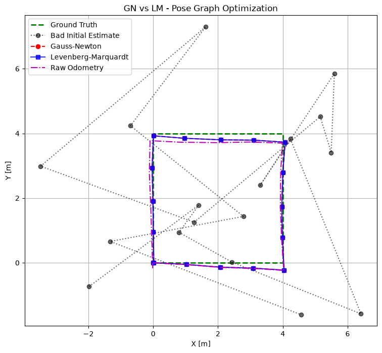
  <figcaption>2026-11-10-01-01-46</figcaption>
</figure>

동일한 Pose Graph에 대해 Gauss-Newton과 Levenberg-Marquardt를 적용한 결과, Bad Initial을 사용하더라도 최종 최적화 결과는 거의 동일했다. 이는 두 알고리즘이 동일한 목적함수를 최소화하기 때문이다. 두 Solver의 차이는 최종 결과보다는 반복 과정, 수렴 속도 및 초기 추정값에 대한 민감도에서 나타날 수 있다.

둘 사이를 비교해본다면 아래 표처럼 표현할 수 있겠지만, 항상 절대적인 것은 아니니 참조만 하자. 

| 상황 | GN | LM |
|---|---|---|
| 초기 추정값이 충분히 좋음 | 빠르게 수렴 가능 | 안정적으로 수렴 |
| 초기 추정값이 나쁨 | 큰 업데이트로 실패 가능 | Damping으로 안정화 가능 |
| 선형화가 정확한 구간 | 효율적 | 추가적인 조절 비용 발생 |
| Local Minimum 존재 | 빠질 수 있음 | 역시 빠질 수 있음 |
| 동일한 최솟값에 수렴 | 동일한 최종해 | 동일한 최종해 |


# 6. 마무리
오늘은 여기까지 해서 GTSAM의 기본적인 개념과 사용법에 대해 배워봤다. 
다음번에는 CPP에서 구현하는 법과 ROS와의 연결을 다뤄보고자한다. 

끗. 